# Architecture diagram

## Claudeモデル進化の図解制作（2026-09-16）

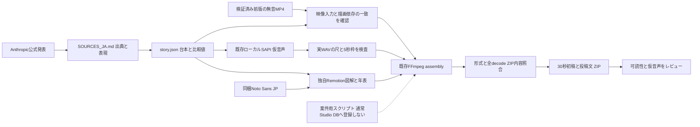

## Claudeの準備操作と撮影の分離（2026-09-12・現行schema 14）

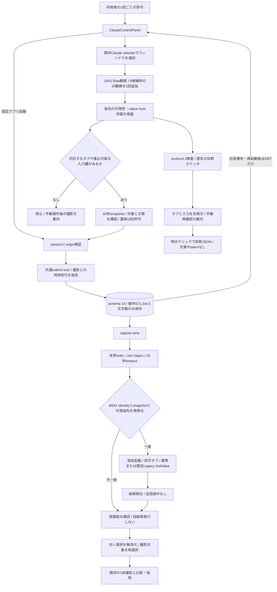

Computer Use経路では、Chatの描画後に要素を取得できた一方、Codeへ移動後も隠れたChat側のtreeが残る挙動を観察した。新しいUIA3ヘルパーによる実起動・実入力・実タブ切替は未受入。図の操作経路は実装＋合成境界試験の範囲。Terminal／CLIの操作は含まない。候補取得の再観察は読取りのみで、操作失敗後の再送や方式切替はしない。

## 場面撮影 → 比較 → 明示採用（2026-09-11追加・schema 13由来）

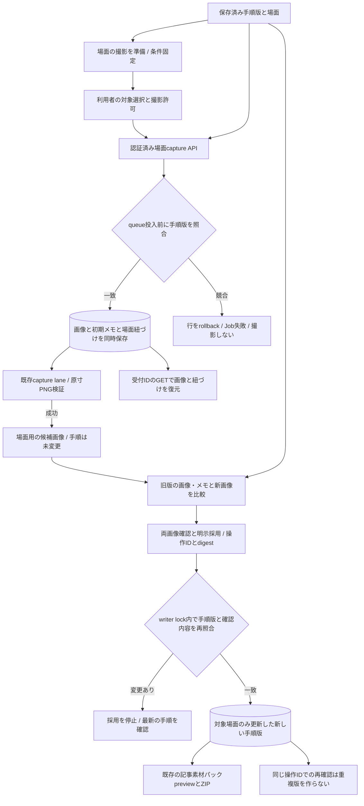

撮影と採用は別の操作。元画像と過去の手順版は保持する。通信応答が不明でも自動で再撮影・再採用しない。native選択tokenは永続化せず、画面内の入力・スクロール・CLIコマンド実行へは接続しない。以下の図は各機能導入時点のschema番号を含む。

## 確認済み記事素材パック（2026-09-10）

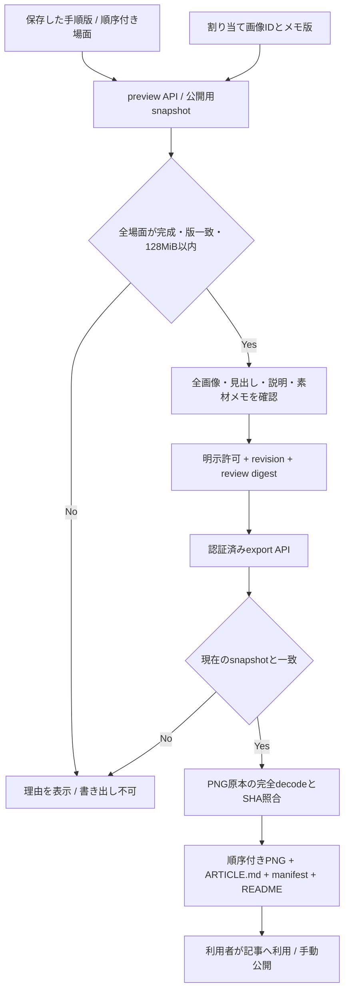

元URL・セレクター・token・過去メモは配布snapshotに含めない。画像そのものと手入力の説明の機密確認は人が行う。native撮影の追加操作は発生しない。

## 保存可能な撮影手順（2026-09-10）

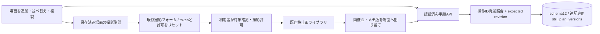

手順は実行スクリプトではない。保存・準備・複製だけでは画像取得や外部API課金は発生しない。

## CLI素材用Terminalアダプター（2026-09-10）

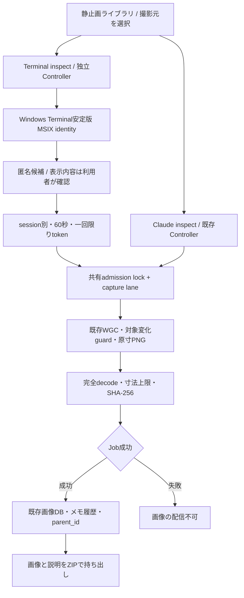

TerminalとClaudeのtokenは相互利用不可。Terminal画面にClaude Code CLIがあるかは自動検証しない。コマンド実行・タブ切替・スクロール・動画撮影・音声取得には接続しない。タブ名・分割ペインを含む画像全体の機密確認は利用者が行う。

## Claude直接PNG・選択と収録の分離（2026-09-10）

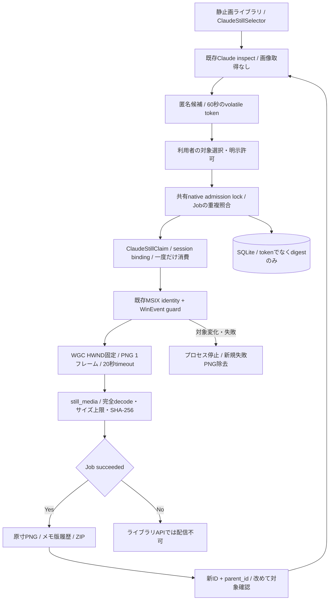

専用still claimは既存の15〜30秒動画claimと交換不可。画面移動・入力・スクロール・音声取得・動画エンコード・全画面fallbackへは接続しない。原寸PNGの寸法はWin32 client座標の値ではなく、WGCが返したピクセル寸法を正として記録する。

## 静止画ライブラリ・Production不要の素材収集（2026-09-10）

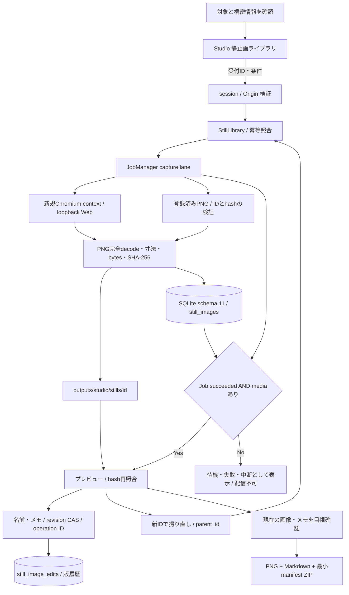

動画Run・生成モデル・有料API・ログイン済みアプリの操作・公開先へは接続しない。Jobの途中成果物は成功画像へ昇格しない。元画像と過去メモを残し、書き出しZIPには現在版のメモだけを含める。

## 30秒テーマ適用・案件用6発話経路（2026-09-09）

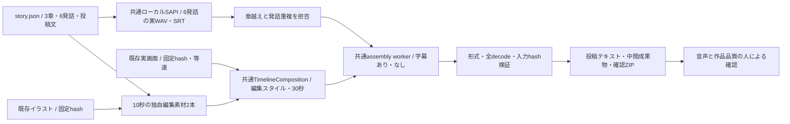

この経路は案件用スクリプトで、Studio DBの保存recipe／Run／QC Jobは作らない。workerのrun形式パスはファイル作業名前空間にすぎない。通常UIの1章1発話契約は変更せず、音声ノイズ改善・有料API・公開処理は含めない。

## 構成チェックと選択式の章演出（2026-09-08）

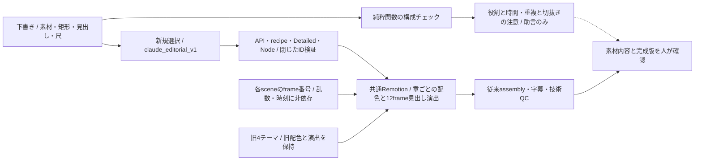

構成チェックから自動編集・追加収録・課金・生成開始へのedgeはない。IDと矩形の重複は映像内容が同じ証拠ではなく、問題なし表示も品質合格ではない。

## 独自イラストと実画面の混在制作（2026-09-06）

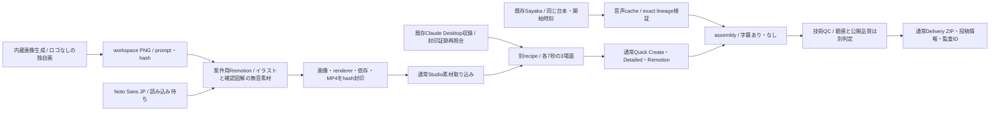

案件用の準備処理から汎用provider追加、ロゴ配信、新規会話送信、再収録、課金TTSへのedgeはない。イラストと編集図解には画面上の種別表記を置き、実UIや思考過程の再現とは扱わない。

## 外観テーマを共通制作経路へ渡す（2026-09-06）

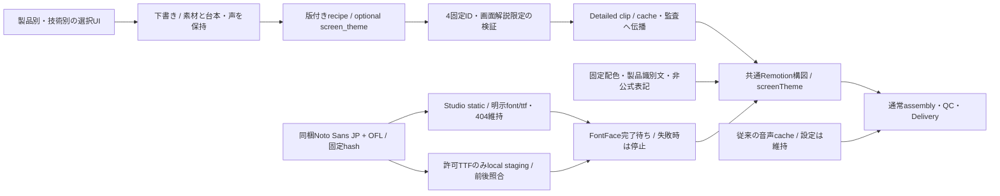

テーマ定義とフォント類もレンダラーのソース識別に含める。製品ロゴ・任意URL・外部フォント取得へのedgeはない。Claude Codeテーマは選択可能だが、現在のDesktop通常チャット素材をCode操作の証拠にはしない。これは外観4種の切替であり、場面構成を自動生成する4種の動画エンジンではない。

## 全体構図と原音固定の聴き比べ（2026-09-06追補）

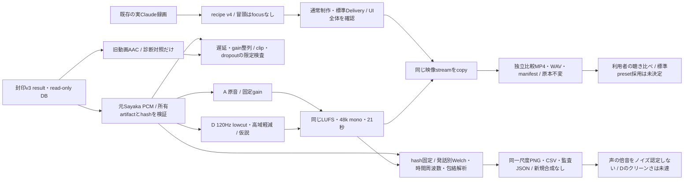

数値検査は聴感合格ではない。原音とAACの波形はほぼ一致しており、AAC工程の新ノイズを確定していない。強いgateや声帯周期notch、課金TTS、別音声fallbackは使わない。WinRTの同声診断はSayaka未登録のため生成0回、SAPI明示format試験は1文を24k／48kで各1回だけ。詳細は[音声比較記録](productions/SHORT_20260906_claude_desktop_real_capture/AUDIO_REVIEW_JA.md)。

### Local SAPIの連続再利用

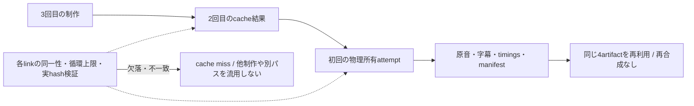

2回目のRun内に原音があると仮定せず、参照の最終所有Runを検査する。原本をコピーして来歴を隠さない。3runの成立は隔離回帰テストで確認したもので、過去のv4 `cache_hit: false`を変更しない。

## 承認済みデモから通常制作へ（2026-09-06）

```mermaid
flowchart LR
    Approved[利用者が架空データ1件の送信を了承] --> CUA[Computer UseでClaudeへ送信]
    CUA --> Ready[回答を確認・個人履歴を非表示]
    Ready --> Capture[produce.py capture / workspace lock]
    Capture --> Source[通常source Job / 元MP4と6成果物]
    Source --> Sealed[受付・Job・hashを保存]
    Sealed --> Request[request.json / 3区間・固定拡大・台本]
    Request --> Render[通常Quick Create / Detailed Job]
    Render --> Speech[SAPI / 成功を実合成で確認]
    Host[既存PowerShell 7優先 / 未導入なら従来ホスト] --> Speech
    Speech --> Cache[音声cache v2 / 旧成果物は保持]
    Cache --> Assembly[Remotion・FFmpeg・技術QC]
    Assembly --> Delivery[既存Delivery / 字幕あり・なし・投稿情報]
    Delivery --> Review[可読性・発音・聴感は別途受入]
```

録画ドライバーはClaudeへの送信・追加依頼・公開を行わない。編集で待ち時間を省くため、完成尺をClaudeの生成速度とは扱わない。失敗した音声Runは残し、入力素材の再収録や追加送信で隠さない。制作の現在地は[制作記録](productions/SHORT_20260906_claude_desktop_real_capture/PRODUCTION_RECORD_JA.md)を参照。

この経路で21秒の実Claude試作v3が標準納品まで成功した。v2から場面2のtrimのみ変更し、音声4成果物は同一ID／hashでcache再利用。両MP4の全decodeと13項目のZIP来歴を確認済み。図の最後の可読性・聴感・公開品質の受入は未完了である。以下の初回スモークに関する説明は当時の履歴として残す。

## Claude Desktop: 1回の素材収録と3場面への再利用（2026-09-06追補）

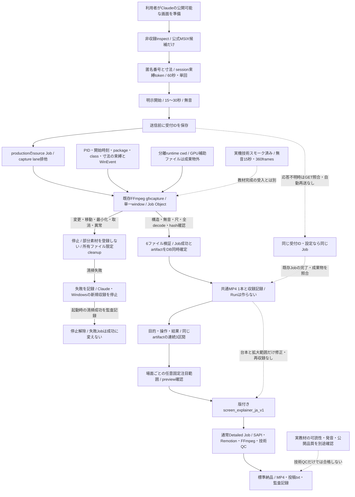

inspectはpixel・音声を取得せず、タイトル・会話・パス・HWNDは公開しない。private identityとtokenはメモリだけに保持し、永続記録には受付IDとdigestを使う。対応はOSが確認する公式MSIX版に限定し、非MSIX版や任意アプリ、全画面へのfallbackはない。対象の自動操作や会話送信も行わない。

新規収録Jobは素材取得専用で、架空の成功Run・narration・assemblyを作らない。無音素材からAV同期gate合格を作ることもない。要求尺は24fpsで切り上げ、実測は要求以上・1frame未満の超過だけ許可する。起動時cleanupはそのDBに属する未完了requestの既知ファイルに限定する。

固定注目範囲は元MP4に対する0〜1の矩形を960×540枠へ拡大する。未指定なら全画面contain。自動追尾・OCR・動的zoom・自動秘匿ではない。実装・非収録inspect・実収録の技術スモークと、3場面の教材完成・公開品質の受入を分離する。後者は未完了。

初回のClaude白画面は主担当の操作で表示復帰したが、原因は未特定。個人の会話・アカウント名を表示しない画面で、標準source Jobが無音15秒・1920×1080・24fpsの収録と6成果物登録に成功した。一方、準備中のCUA手動操作で「新規アーティファクト」をクリックするとClaude側が依頼文1件を送信して生成を開始したため、想定外の処理として停止した。停止ボタン消失を確認し、生成成果物は得ていない。この副作用はStudio収録機能の自動送信ではないが、「今回のClaudeへの送信は一切なし」とは記録しない。有料API利用・外部投稿は行っていない。

## 画面解説: 素材準備から標準納品（2026-09-06）

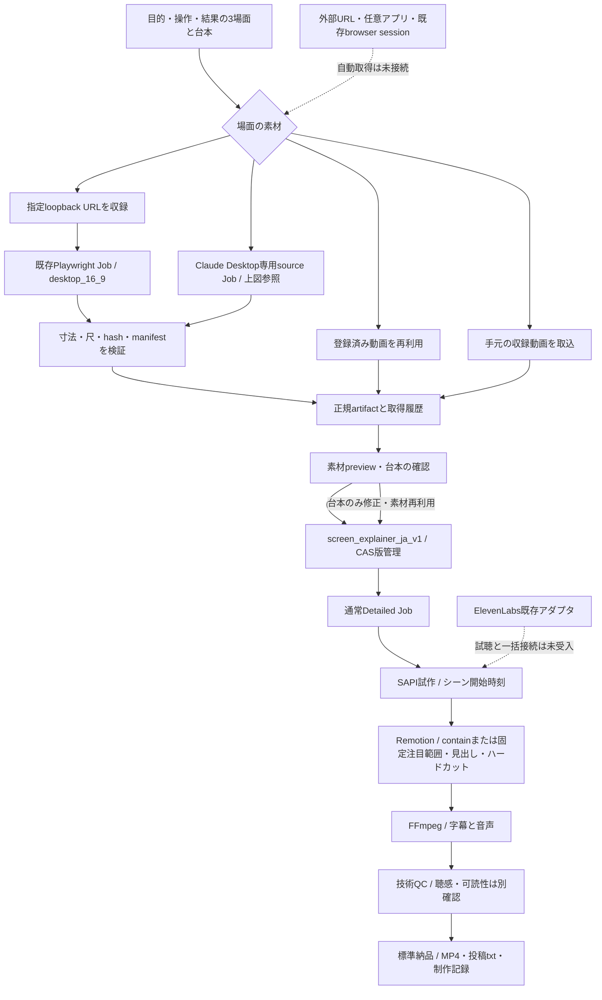

## 音声ノイズ低減の比較経路（2026-09-05）

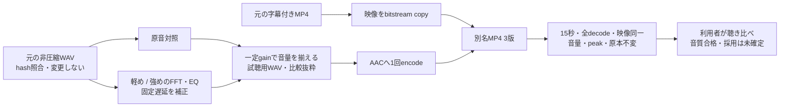

案件専用のローカル比較であり、標準Studioの既定値や成功Run／Jobを変更しない。帯域energyの減少だけをノイズ除去成功と見なさず、原版は保存したままにする。

## 生成画像＋決定的アニメーションの案件経路（2026-09-05）

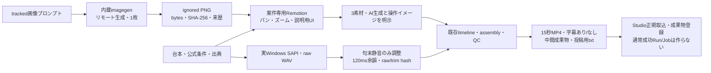

対象は `SHORT_20260905_claude_desktop_15s`。内蔵画像生成は外部境界を越えるが、その後の描画・音声・合成はローカルで行う。MiniMax動画推論、外部TTS、YouTube投稿への接続はない。Studioの汎用画像生成機能を追加した図ではない。

## 案件専用モーショングラフィックスの経路（2026-09-05）

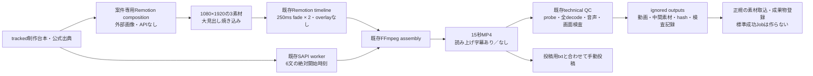

これは`SHORT_20260905_codex_15s`用の再現スクリプト。通常の「かんたん制作」や標準納品ZIPの実行履歴と混同しない。

この図は、tracked workspace、untracked local runtime、Studio、外部配布元、MiniMax API、ElevenLabs API、YouTube Data APIの信頼境界と主要データフローを示します。責務と制約の詳細は[ARCHITECTURE.md](ARCHITECTURE.md)を参照してください。

## 現在の優先導線（2026-09-05）

当面は手動投稿を出口とする。下段の全体図にあるYouTube APIは既存control-planeの構成であり、今回のStudio操作からは送信しない。

```mermaid
flowchart LR
    Import["動画取込<br/>既存ffprobe・SHA-256検証"] --> Facts["6項目の素材情報<br/>production JSON＋SQLite v10"]
    Words["用途・主文"] --> Script["実行前の3場面台本<br/>compilerと同じ見出し・セリフ"]
    Facts --> Edit["1. 作る<br/>素材範囲再生・文字量の助言<br/>対象素材だけ固定鮮明化"]
    Script --> Edit
    Edit --> Existing["既存recipe・Run・Job<br/>SAPI → Remotion → 合成 → 技術QC"]
    Existing --> Review["2. 確認・修正<br/>完成動画・表現・音声を人が確認"]
    Review -->|設定変更・再作成| Edit
    Review --> Delivery["3. 動画・投稿用テキスト"]
    Delivery --> MP4["読み上げ字幕あり／なしMP4<br/>大見出しは両方に残る"]
    Delivery --> Text["現在入力のタイトル・説明・タグ<br/>UTF-8 txt・コピー"]
    Delivery --> Zip["既存13ファイル納品ZIP<br/>送信時snapshotとの差分を表示"]
    MP4 --> Manual["利用者が手動で投稿"]
    Text --> Manual
    Edit -.-> Advanced["詳細ツール<br/>収録・音声・編集・ログ・監査"]
```

素材情報のGETは再probeしない。古い／変更された素材の情報は不明とし、renderer側の再検証は省略しない。文章量の助言と素材previewは完成画質・音声の合格判定ではない。

## 全体構成

RemotionのPNG frame scratchは、開始前にsharpカットを各2GiB、preserveカットを実source bytesとして予約し、source staging後に実staged bytesと残容量を再検査します。残りの必要量はRGBA frame bytes×1.25＋raw出力2GiB＋正規化出力2GiB＋安全余白1GiBです。`TEMP`／`TMP`／`TMPDIR`をatomic stage内へ閉じてNode側でもattestし、成功・失敗・cancelの全経路でstageを削除します。両検査値と実staged bytesをreport／manifestへ記録します。

```mermaid
flowchart LR
    Operator["Operator<br/>PowerShell / browser"]

    subgraph Workspace["Tracked workspace"]
        Setup["setup-local.ps1"]
        RuntimeLock["runtime-lock.json<br/>requirements-local-lock.txt"]
        Downloader["download-models.ps1"]
        ModelManifest["model-manifest.json"]
        Doctor["tools/local_doctor.py"]
        Launcher["run-local.ps1<br/>profile custom-node allowlist"]
        Metrics["tools/system_metrics.ps1<br/>start / end snapshot"]
        LowWorkflow["lowvram workflow<br/>GGUF / 0.2MP / 4s / 20 steps"]
        TurboWorkflow["optional Turbo workflow<br/>GGUF + LoRA / 0.2MP / 5s / 6 steps"]
        Q4TurboWorkflow["quality Q4 Turbo workflow<br/>Q3 + Q4 + LoRA / 0.4MP / 5s / 8 steps"]
        OfficialQ4Workflow["official INT8 + Q4 workflow<br/>0.4MP / 5s / stock 20 steps"]
        OfficialQ4TurboWorkflow["official INT8 + Q4 Turbo workflow<br/>0.4MP / 5s / Turbo 8 steps"]
        StudioApiWorkflow["Studio API workflow<br/>official INT8 + Q4 / portrait<br/>124 frames / 24fps / 20 steps"]
        ApiWrapper["run-api.ps1"]
        ApiCli["tools/h3_api.py"]
        ProductionLedgers["productions/&lt;id&gt;<br/>tracked ledgers / manifests"]
        StudioSetup["setup-studio.ps1"]
        StudioLauncher["run-studio.ps1"]
        StudioFrontend["studio/<br/>React / Vite source"]
        StudioBackend["tools/studio/<br/>local API / index / audit"]
        HttpLifecycle["server.py HTTP lifecycle<br/>Connection: close / parse-phase interruption<br/>parsed handler drain"]
        ShutdownGate["service.py + jobs.py shutdown gate<br/>full-manager unregistered-descendant sweep<br/>provider recovery / worker lanes / DB writer"]
        ProviderRecovery["service.py startup recovery<br/>background scan / bounded observe"]
        PipelineContinuationCoordinator["service.py pipeline continuation<br/>exact repair + fair cancel retry<br/>manager-lock CAS fence / enqueue-only"]
        LocalPipelineContract["pipeline.py<br/>schema v4 / exact local payload / canonical key"]
        LocalPipelineOrchestrator["local_pipeline orchestrator<br/>one immutable parent / five executed stages"]
        DetailedTestContract["detailed_test_video.py<br/>exact schema v1 / fixed Shorts preflight<br/>content-addressed request"]
        DetailedTestOrchestrator["Detailed Test Video v1<br/>SAPI -> Remotion -> assembly -> QC<br/>child lineage + bounded public result"]
        AnnouncementContract["announcement_video.py<br/>HOOK / MESSAGE / CTA recipe v1<br/>fixed compile to Detailed"]
        QuickCreatePresentation["QuickCreateForm.tsx<br/>かんたん作成 3-step presentation<br/>fixed announcement defaults / no direct API"]
        AnnouncementTemplateUi["Studio かんたん作成 tab<br/>quick / detailed settings<br/>shared save / revision / clone / execute"]
        AnnouncementRequestGuard["announcementRecovery.ts + App request guard<br/>15s AbortSignal / selected generation<br/>deterministic clone ID / durable intent"]
        ProductionIntakeContract["production_intake.py<br/>exact create + bounded raw video import<br/>SHA-256 / ffprobe / atomic publish"]
        SimpleCreateWizard["SimpleCreateWizard.tsx<br/>about five decisions / 3 fixed templates<br/>stable local intent / existing endpoints"]
        ProductionLibraryContract["production_library.py<br/>rename / archive / duplicate<br/>non-destructive operation ledger"]
        ReviewContract["reviews.py + ReviewPanel.tsx<br/>artifact / revision / run / cut / timecode<br/>immutable actions + explicit human gates"]
        JobControlContract["job_control.py + JobManager<br/>exact-ID registered process-tree cancel<br/>requested vs worker-retired truth"]
        QuickCreateProjectContract["quick_create_project.py<br/>production + 1..3 relative videos<br/>indexed recipe / shared deadline / redaction"]
        ShotProjectContract["shot_orchestration.py<br/>3 first frames + exact I2VA prompts<br/>3-task cap / resume / exact 15s compile"]
        StudioComfyContract["comfyui_execution.py<br/>fixed payload / provenance / cache contract"]
        StudioComfyWorker["comfyui.py<br/>pre-issued UUID / observe / resume / targeted cancel / cache"]
        NarrationWorker["tools/studio/narration.py<br/>validated SAPI worker / cache"]
        ExternalTtsContract["external_tts_execution.py<br/>strict payload / cache / result contract"]
        ElevenLabsWorker["elevenlabs.py<br/>bounded with-timestamps adapter / cache"]
        ScreenCaptureContract["browser_capture_execution.py<br/>local_playwright: screen_capture + timeline<br/>assembly / qc remain plan-only"]
        ScreenCaptureWorker["browser_capture.py + playwright_capture.mjs<br/>isolated Chromium / bounded capture<br/>fixed MP4 conversion + atomic publish"]
        PlaywrightDoctor["playwright_doctor.mjs<br/>pinned package / Chromium launch check"]
        WindowsCaptureCapability["windows_capture.py<br/>empty-object non-recording inspector<br/>strict request / result identity"]
        WindowsCaptureContract["windows_capture.py<br/>60s one-use session-bound consent<br/>dual confirmation / fixed capture only"]
        WindowsCaptureWorker["windows_capture_worker.py<br/>kill-on-close Job Object + start gate<br/>structural timing checks + live A/V gate"]
        WindowsCaptureHelperSource["native/windows-capture-helper<br/>Core Audio doctor + fixed PCM source<br/>no external NuGet package"]
        TimelineWorker["tools/studio/timeline.py<br/>local_sapi + local_playwright timeline<br/>validated hard-cut worker / cache"]
        RemotionContract["remotion_timeline_execution.py<br/>schema v1 / closed edit + visual preset<br/>local_remotion_timeline"]
        SourceFidelityPolicy["remotion-source-fidelity-v2<br/>preserve / low-res portrait sharp<br/>fixed cache + audit + manifest policy"]
        RemotionWorker["remotion_timeline.py + remotion_render.mjs<br/>pre-overlay FFmpeg + Remotion 4.0.517<br/>PNG frames / CRF 16 / concurrency 1"]
        RemotionComposition["studio/src/remotion + api/status/types<br/>shared Player / renderer build closure"]
        RemotionDoctor["remotion_doctor.mjs<br/>dependency closure attestation<br/>exact packages / Chromium reuse check"]
        AssemblyWorker["tools/studio/assembly.py<br/>validated FFmpeg worker / cache<br/>closed caption + audio mix presets"]
        QcWorker["tools/studio/qc.py<br/>technical QC v2 / cache<br/>loudness + peak + black hard checks<br/>long-static advisory"]
        DeliveryContract["delivery.py + DeliveryPanel.tsx<br/>verified local package / 3 thumbnails<br/>ZIP manifest + SHA-256 sidecar"]
        VoiceUpgradeCore["voice_upgrade.py + voice_upgrade_execution.py<br/>closed alignment + exact source/result binding<br/>zero-network Job / no Studio UI"]
        CaptureAcceptance["windows_capture_acceptance.py<br/>A/V + loudness + device / exit evidence<br/>5 operator attestations"]
        YouTubeBinding["youtube_publish_binding.py<br/>delivery + selected master<br/>3 approved human gates"]
        YouTubePublishContract["youtube_publish.py + service routes<br/>preview -> explicit execute<br/>private / unlisted only"]
        YouTubePublishExecution["youtube_publish_execution.py<br/>resume acknowledged bytes<br/>no ambiguous re-initiation"]
        SapiHelper["sapi_synthesize.ps1<br/>UTF-8 JSON IPC"]
        StudioCli["tools.studio.cli<br/>secret + test-video + quick-create<br/>quick-create-project + shot-project"]
        TestVideoOrchestrator["test_video.py<br/>ordered local orchestration<br/>bounded result"]
    end

    subgraph LocalSecrets["Local secret / untracked boundary"]
        Env["process env / .env<br/>MiniMax + ElevenLabs + YouTube credential"]
        StudioSecrets["outputs/studio/secrets<br/>Windows DPAPI ciphertext"]
    end

    subgraph LocalRuntime["Untracked local boundary"]
        Venv[".venv<br/>Python 3.12 + locked packages"]
        Comfy["ComfyUI on 127.0.0.1<br/>native H3 nodes + chunked VAE I/O"]
        GgufNode["ComfyUI-GGUF"]
        TurboNode["MiniMax H3 Turbo node<br/>pinned custom code + time grid"]
        Models["models<br/>lowvram / Q2 Turbo / Q4 Turbo / official / official Q4"]
        OfficialWorkflow["Template Library<br/>official H3 T2V"]
        Outputs["MP4 outputs / temp"]
        HardwareMetrics["Windows CIM / sensor WMI<br/>NVIDIA nvidia-smi"]
        StudioBuild["studio/node_modules + dist"]
        StudioUi["Studio UI<br/>127.0.0.1 only"]
        StudioDb["outputs/studio/studio.sqlite3<br/>schema v9 / immutable run + job-attempt link<br/>library state + operation ledger"]
        WorkspaceLock["system-wide workspace lock<br/>held until full drain, retry, or process exit"]
        VideoClaims["local_video_generation_claims<br/>Run + cache + payload digest<br/>one active job"]
        ProviderTasks["provider_tasks ledger<br/>state + CAS owner / exact-once submission<br/>cancel_requested fence / DPAPI restart payload"]
        PipelineClaims["local_pipeline_claims<br/>continuation state + CAS<br/>DPAPI request / video checkpoint"]
        DetailedTestClaims["detailed_test_video_claims<br/>production + request key<br/>immutable Run / active top / retry"]
        AnnouncementEvents["production events<br/>exact Base64 recipe revisions<br/>atomic Detailed job links"]
        ReviewEvents["production events<br/>review action projection<br/>planned_not_executed cut plans"]
        ShotProjectState["outputs/studio/shot_projects<br/>plan.json + state.json + 3 MP4<br/>hashes / provider task IDs / no secret"]
        StudioEvents["outputs/studio/events<br/>hash-chained JSONL mirror"]
        ExternalSubmissionState["outputs/studio/external-submissions<br/>production/cache ambiguity marker"]
        GpuLane["Studio GPU FIFO lane<br/>single ComfyUI worker"]
        PipelineLane["Studio pipeline FIFO lane<br/>local_pipeline + detailed-test top jobs<br/>child coordination"]
        BrowserLane["Studio browser FIFO lane<br/>capture + Remotion timeline / one job"]
        CaptureLane["Studio native capture FIFO lane<br/>one active / no delayed recording queue"]
        WindowsCaptureConsents["windows_capture_consent_intents<br/>digest only / 60s / append-only<br/>atomic consume + attempt + Job"]
        WindowsCaptureCleanupLedger["windows-capture-cleanup-ledger.json<br/>run + capture digest + target kind only<br/>atomic fsync fallback / exact restart cleanup"]
        DefaultLane["Studio default child lane<br/>SAPI + FFmpeg FIFO"]
        PinnedChromium["Playwright 1.62.1 Chromium<br/>fresh context / no persistent profile"]
        LoopbackWebTarget["explicit loopback Web target<br/>127.0.0.1 + exact port"]
        ScreenCaptureOutputs["outputs/studio/runs/.../screen_capture<br/>MP4 / raw WebM / first + last PNG<br/>report / ffprobe / manifest"]
        WindowsCaptureOutputs["outputs/studio/runs/.../screen_capture<br/>deterministic private partial -> publish<br/>8 structurally verified artifacts / live A/V gate"]
        VideoGenerationOutputs["outputs/studio/runs/.../video_generation<br/>MP4 / workflow / ffprobe / manifest"]
        NarrationOutputs["outputs/studio/runs/.../narration<br/>WAV / SRT / timing / manifest"]
        TimelineOutputs["outputs/studio/runs/.../timeline<br/>preview MP4 / timeline / ffprobe / manifest"]
        RemotionOutputs["outputs/studio/runs/.../remotion_timeline<br/>MP4 / timeline / render report<br/>ffprobe / manifest"]
        AssemblyOutputs["outputs/studio/runs/.../assembly<br/>clean / captioned MP4 / ffprobe / manifest"]
        QcOutputs["outputs/studio/runs/.../qc<br/>technical QC / ffprobe / manifest"]
        DeliveryOutputs["outputs/studio/deliveries<br/>delivery-package.zip + .sha256<br/>clean / captioned / SRT / QC / audit"]
        VoiceUpgradeOutputs["local voice-upgrade cache<br/>aligned WAV / SRT / timing / manifest"]
        YouTubePublishLedger["outputs/studio/youtube<br/>public state + staged source<br/>session URI in separate DPAPI ciphertext"]
        AuditExports["outputs/studio/audits<br/>ZIP + SHA-256 sidecar"]
        ProductionArtifacts["outputs/productions<br/>media / logs / QC / imported videos"]
        ProductionControlMetadata[".studio-production.json<br/>title + import relative path -> SHA-256<br/>hidden partials / not an artifact"]
        WindowsSapi["Windows System.Speech<br/>installed local voices"]
        MediaTools["FFmpeg / ffprobe<br/>resolved binary identity"]
        WindowsCaptureHelper["Release net8.0-windows helper DLL<br/>doctor Initialize only<br/>gated PCM + timestamp/gap checks"]
        WindowsDefaultRender["Windows Core Audio<br/>default render / console endpoint<br/>identity never returned"]
    end

    subgraph ExternalSources["External supply-chain boundary"]
        GitHub["GitHub<br/>pinned repository commits"]
        PackageIndexes["PyTorch cu130 / PyPI / npm<br/>locked or package-managed dependencies"]
        HuggingFace["Hugging Face<br/>pinned model revisions"]
    end

    subgraph MiniMaxBoundary["MiniMax service boundary"]
        MiniMaxApi["MiniMax V2 API<br/>billable submit / query"]
        OutputCdn["Output CDN<br/>MP4 URL"]
    end

    subgraph ElevenLabsBoundary["ElevenLabs service boundary"]
        ElevenLabsApi["ElevenLabs with-timestamps API<br/>billable single POST"]
    end

    subgraph YouTubeBoundary["Google / YouTube service boundary"]
        YouTubeApi["YouTube Data API v3<br/>OAuth channel lookup + videos.insert<br/>resumable upload"]
    end

    Operator --> Setup
    RuntimeLock --> Setup
    GitHub --> Setup
    PackageIndexes --> Setup
    Setup --> Venv
    Setup --> Comfy
    Setup --> GgufNode
    Setup --> TurboNode

    Operator -->|"-AcceptLicense"| Downloader
    ModelManifest --> Downloader
    HuggingFace --> Downloader
    Downloader --> Models

    Operator --> Doctor
    RuntimeLock --> Doctor
    ModelManifest --> Doctor
    Doctor -->|"read-only checks"| Venv
    Doctor -->|"HEAD / nodes / resources"| Comfy
    Doctor -->|"size / optional SHA-256"| Models
    Doctor -->|"profile contract"| LowWorkflow
    Doctor -->|"Turbo wiring / merge contract"| TurboWorkflow
    Doctor -->|"Q4 loader / 0.4MP / 8-step contract"| Q4TurboWorkflow
    Doctor -->|"INT8 + Q4 / 20-step contract"| OfficialQ4Workflow
    Doctor -->|"INT8 + Q4 Turbo / 8-step contract"| OfficialQ4TurboWorkflow
    Doctor -->|"profile contract"| OfficialWorkflow

    Operator --> Launcher
    Doctor -->|"Ready gate"| Launcher
    Launcher -->|"start and end only"| Metrics
    Metrics -->|"read-only snapshot"| HardwareMetrics
    Launcher -->|"loopback + all custom nodes disabled<br/>profile exact allowlist<br/>Dynamic VRAM or emergency CPU VAE"| Comfy
    LowWorkflow -->|"lowvram only"| Comfy
    TurboWorkflow -->|"lowvram_turbo only"| Comfy
    Q4TurboWorkflow -->|"lowvram_q4_turbo only"| Comfy
    OfficialWorkflow -->|"official only"| Comfy
    OfficialQ4Workflow -->|"official_q4 only"| Comfy
    OfficialQ4TurboWorkflow -->|"official_q4_turbo only"| Comfy
    GgufNode --> Comfy
    TurboNode -->|"optional LoRA + sampler"| Comfy
    Models --> Comfy
    Comfy --> Outputs

    Operator --> ApiWrapper
    Env --> ApiCli
    ApiWrapper --> ApiCli
    ApiCli -->|"POST only with --confirm-billable<br/>Bearer, redirects rejected"| MiniMaxApi
    MiniMaxApi -->|"task id / status"| ApiCli
    MiniMaxApi -->|"completed MP4 location"| OutputCdn
    OutputCdn -->|"GET without Authorization"| ApiCli
    ApiCli --> Outputs

    Operator --> StudioSetup
    PackageIndexes -->|"npm registry"| StudioSetup
    StudioFrontend --> StudioSetup
    StudioSetup --> StudioBuild
    WindowsCaptureHelperSource --> StudioSetup
    StudioSetup -->|"Release build only<br/>doctor waits for explicit UI action"| WindowsCaptureHelper
    StudioSetup -->|"install + fail-closed launch check"| PlaywrightDoctor
    PlaywrightDoctor --> PinnedChromium
    StudioSetup -->|"npm ci後にclosure attestation生成<br/>exact 4.0.517 package check"| RemotionDoctor
    RemotionDoctor -->|"reuse installed executable"| PinnedChromium
    RemotionComposition --> StudioFrontend
    Operator --> StudioLauncher
    StudioLauncher -->|"python -m tools.studio.server"| HttpLifecycle
    StudioLauncher -->|"acquire before service construction"| WorkspaceLock
    HttpLifecycle -->|"parsed request"| StudioBackend
    HttpLifecycle -->|"shutdown: interrupt parse sockets<br/>drain parsed handlers"| ShutdownGate
    StudioBackend -->|"drain provider recovery<br/>worker lanes + DB interrupt writer"| ShutdownGate
    ShutdownGate -->|"all drained: release"| WorkspaceLock
    ShutdownGate -->|"timeout/failure: retain"| WorkspaceLock
    StudioBuild -->|"normal: static dist<br/>Dev: Vite"| StudioUi
    StudioUi -->|"GET: loopback Host<br/>POST: cookie/session + Origin"| HttpLifecycle
    StudioUi -->|"2s polling: top/child job status + progress%"| StudioBackend
    StudioUi -->|"default tab / beginner inputs"| QuickCreatePresentation
    QuickCreatePresentation -->|"same draft + saveAndExecute controller<br/>no new endpoint"| AnnouncementTemplateUi
    StudioUi -->|"詳細設定 / muted Player preview"| AnnouncementTemplateUi
    AnnouncementTemplateUi -->|"save / duplicate / execute<br/>2s jobs / approx 6s production detail"| AnnouncementRequestGuard
    AnnouncementRequestGuard -->|"15s abort / selected production only<br/>stable save or clone identity<br/>fresh exact Job / then manual reconcile"| StudioBackend
    StudioUi -->|"stable production ID + title intent<br/>draft-bound discard guard<br/>sequential raw File upload"| ProductionIntakeContract
    StudioUi -->|"primary 5-decision flow"| SimpleCreateWizard
    SimpleCreateWizard -->|"create / import / recipe save / execute<br/>one deadline + read-before-write recovery"| StudioBackend
    StudioUi -->|"search / rename / archive / duplicate"| ProductionLibraryContract
    StudioBackend -->|"closed library mutations"| ProductionLibraryContract
    ProductionLibraryContract -->|"state + idempotent operation + audit event"| StudioDb
    StudioUi -->|"time-coded comments / decisions / plan only"| ReviewContract
    StudioBackend -->|"closed review routes"| ReviewContract
    ReviewContract -->|"append-only actions"| ReviewEvents
    ReviewEvents -->|"validated projection"| StudioDb
    StudioBackend -->|"session-protected create/import<br/>service-level intake lock"| ProductionIntakeContract
    ProductionIntakeContract -->|"production-local partial<br/>hash + ffprobe then hard-link publish"| ProductionArtifacts
    ProductionIntakeContract -->|"atomic exact metadata replace"| ProductionControlMetadata
    ProductionControlMetadata -->|"title + known import hashes<br/>control file excluded from artifacts"| StudioBackend
    StudioUi -->|"POST /api/jobs/{id}/cancel<br/>2s x 15 exact retirement rechecks<br/>top pipeline controls suppress children"| JobControlContract
    StudioBackend -->|"resolve exact durable lineage"| JobControlContract
    JobControlContract -->|"cancel requested + worker retirement<br/>terminal retry is a no-op"| StudioDb
    ProductionLedgers -->|"read / refresh index"| StudioBackend
    ProductionArtifacts -->|"registered artifacts only"| StudioBackend
    StudioBackend -->|"atomic artifact + job + stage<br/>terminal transaction"| StudioDb
    StudioBackend -->|"prepared UUID / startup scan<br/>public state / manual resume"| ProviderTasks
    StudioBackend -->|"start without provider I/O"| ProviderRecovery
    ProviderRecovery -->|"bounded exact-ID observation"| ProviderTasks
    ProviderRecovery -->|"exact GET + targeted cancel<br/>never generation POST for known/cancelled task"| Comfy
    StudioBackend -->|"atomic identical-request claim"| VideoClaims
    VideoClaims -->|"single winner queues"| GpuLane
    VideoClaims --> StudioDb
    ProviderTasks -->|"same Run / append recovery attempt<br/>single CAS winner"| GpuLane
    ProviderTasks -->|"provider + job + attempt + artifacts<br/>atomic terminal state"| StudioDb
    ProviderTasks -->|"explicit cancel: job + attempt + fence<br/>one atomic timestamp"| StudioDb
    ProviderTasks -->|"terminal recovery + exact video checkpoint<br/>same transaction"| PipelineClaims
    StudioDb -->|"append"| StudioEvents
    StudioEvents -->|"verified restore<br/>revision / run / cost approval<br/>detailed-test claim / stage attempt<br/>historical job link / hash-verified artifacts"| StudioDb
    StudioEvents -->|"full-chain health / degraded warning"| StudioBackend
    StudioBackend -->|"POST /api/productions/{id}/execute-local-pipeline<br/>schema v4 / immutable zero-cost Run"| LocalPipelineContract
    LocalPipelineContract -->|"canonical pipeline key / exact allowlist"| LocalPipelineOrchestrator
    LocalPipelineOrchestrator -->|"Run + top-job dedupe<br/>protected normalized request"| PipelineClaims
    PipelineClaims -->|"ready checkpoint scan"| PipelineContinuationCoordinator
    PipelineContinuationCoordinator -->|"exact failed-admission ID repair<br/>single CAS winner / enqueue only<br/>video cache-only when checkpointed"| PipelineLane
    PipelineClaims -->|"initial or explicit top"| PipelineLane
    PipelineClaims --> StudioDb
    LocalPipelineOrchestrator -->|"parent cancel waits for child jobs"| StudioDb
    StudioBackend -->|"POST /api/productions/{id}/execute-detailed-test-video<br/>schema v1 / immutable local_sapi zero-cost Run"| DetailedTestContract
    ProductionArtifacts -->|"registered video IDs only<br/>bytes + SHA-256 identity"| DetailedTestContract
    DetailedTestContract -->|"exact allowlist<br/>fixed caption preflight<br/>no path / URL / CSS / free gain"| DetailedTestOrchestrator
    DetailedTestOrchestrator -->|"canonical request key<br/>Run + top-job dedupe"| DetailedTestClaims
    DetailedTestClaims -->|"queued/running or verified success reuse<br/>failed/interrupted same-Run retry"| PipelineLane
    DetailedTestClaims --> StudioDb
    DetailedTestOrchestrator -->|"exact child job/attempt lineage<br/>artifact rehash / cancel-and-wait"| StudioDb
    StudioBackend -->|"GET list + POST save / duplicate / execute<br/>session-protected loopback API"| AnnouncementContract
    ProductionArtifacts -->|"three scene selections<br/>registered video IDs only"| AnnouncementContract
    AnnouncementContract -->|"CAS append / immutable version<br/>clone source + exact canonical JSON"| AnnouncementEvents
    AnnouncementContract -->|"fixed 250ms fades + center/top/center overlays<br/>scene-start-aligned SAPI/SRT + overlap fail closed<br/>same content and timing keeps Detailed dedupe"| DetailedTestContract
    DetailedTestClaims -->|"new/reused top Job + recipe execution link<br/>one SQLite transaction"| AnnouncementEvents
    AnnouncementEvents -->|"hash-chain production records<br/>Base64 is not encryption"| StudioDb
    PipelineLane -->|"GPU child"| GpuLane
    PipelineLane -->|"default children"| DefaultLane
    PipelineLane -->|"detailed-test Remotion child"| BrowserLane
    StudioBackend -->|"local_comfyui / explicit execute<br/>prompt + seed only"| StudioComfyContract
    StudioComfyContract -->|"fixed graph + runtime/model/tool identity"| GpuLane
    StudioApiWorkflow --> StudioComfyContract
    RuntimeLock --> StudioComfyContract
    ModelManifest --> StudioComfyContract
    GpuLane -->|"one job at a time"| StudioComfyWorker
    DefaultLane -->|"SAPI child"| NarrationWorker
    DefaultLane -->|"one generated clip / timeline child"| TimelineWorker
    DefaultLane -->|"assembly child"| AssemblyWorker
    DefaultLane -->|"technical QC child"| QcWorker
    StudioComfyWorker -->|"new task: POST prompt with pre-issued ID<br/>known/cancel task: exact GET + targeted cancel only<br/>proxy and redirects rejected"| Comfy
    Comfy -->|"history output bound to submitted prefix"| StudioComfyWorker
    Models -->|"Windows: every-new-POST guarded SHA-256<br/>non-Windows: physical identity cache"| StudioComfyWorker
    StudioComfyWorker -->|"ffprobe / verified MP4"| MediaTools
    StudioComfyWorker -->|"production/cache marker fsync<br/>pre-issued prompt ID before POST<br/>terminal failure fsync before DB"| ExternalSubmissionState
    StudioComfyWorker -->|"atomic publish + SHA-256"| VideoGenerationOutputs
    VideoGenerationOutputs -->|"4 artifacts registered only with terminal success"| StudioBackend
    StudioBackend -->|"local_sapi / explicit execute<br/>persist job-attempt link before queue"| NarrationWorker
    NarrationWorker -->|"validated JSON file"| SapiHelper
    SapiHelper --> WindowsSapi
    WindowsSapi -->|"segment WAV"| NarrationWorker
    NarrationWorker -->|"atomic output + SHA-256"| NarrationOutputs
    NarrationOutputs -->|"exact path / kind / MIME / hash allowlist"| StudioBackend
    StudioBackend -->|"elevenlabs_tts + narration<br/>positive estimate + approval + confirm_billable<br/>cache checked before secret"| ExternalTtsContract
    ExternalTtsContract -->|"allowlisted fixed-model payload"| ElevenLabsWorker
    StudioSecrets -->|"resolve after all gates<br/>value never returned"| ElevenLabsWorker
    Env -->|"env, then .env, then DPAPI<br/>resolve after all gates"| ElevenLabsWorker
    ElevenLabsWorker -->|"exclusive marker before POST<br/>remove only after verified publish"| ExternalSubmissionState
    ElevenLabsWorker -->|"fixed HTTPS / xi-api-key<br/>redirects rejected / bounded deadline"| ElevenLabsApi
    ElevenLabsApi -->|"audio_base64 + character alignment<br/>request-id + character-cost"| ElevenLabsWorker
    ElevenLabsWorker -->|"MP3 decode / shell=false"| MediaTools
    ElevenLabsWorker -->|"atomic WAV / SRT / timing / manifest<br/>actual_cost remains null"| NarrationOutputs
    StudioBackend -->|"POST /api/runs/{id}/execute-voice-upgrade<br/>elevenlabs_tts narration only"| VoiceUpgradeCore
    NarrationOutputs -->|"succeeded ElevenLabs attempt<br/>registered WAV + timing reverified"| VoiceUpgradeCore
    VoiceUpgradeCore -->|"voice_upgrade Job + atomic attempt/artifacts<br/>closed 3-scene schedule / zero cost"| VoiceUpgradeOutputs
    VoiceUpgradeOutputs -->|"registered public result + 4 artifacts<br/>strictly reverified before assembly"| AssemblyWorker
    StudioBackend -->|"POST /api/runs/{id}/execute-local-screen-capture<br/>local_playwright / explicit zero-cost execute"| ScreenCaptureContract
    StudioUi -->|"POST /api/capabilities/windows-capture/inspect<br/>exact empty object / explicit button"| StudioBackend
    StudioBackend -->|"no DB / Job / artifact / event<br/>10s + 64KiB bounded probes"| WindowsCaptureCapability
    WindowsCaptureCapability -->|"fixed DLL/source/tool identity + doctor<br/>ready enables separate route / no sample"| WindowsCaptureHelper
    WindowsCaptureCapability -->|"gdigrab + ffprobe availability<br/>no screen sample"| MediaTools
    WindowsCaptureHelper -->|"doctor: GetDefaultAudioEndpoint + Initialize<br/>no Start / no GetBuffer / no device ID"| WindowsDefaultRender
    StudioUi -->|"POST consent-intents<br/>duration + two literal confirmations"| StudioBackend
    StudioBackend -->|"issue: no recording<br/>raw token returned once"| WindowsCaptureContract
    WindowsCaptureContract -->|"one-way token + session/settings binding"| WindowsCaptureConsents
    WindowsCaptureConsents -->|"atomic consume + attempt + Job<br/>same token always resolves original Job"| StudioDb
    StudioUi -->|"POST execute-windows-capture<br/>same settings + in-memory token"| StudioBackend
    StudioUi -->|"POST cancel-windows-capture {}<br/>exact native job only"| StudioBackend
    StudioBackend -->|"local_windows_capture / zero cost<br/>fresh consent + exclusive admission"| WindowsCaptureContract
    WindowsCaptureContract -->|"consumed-token replay = original Job<br/>other active or retiring = reject"| CaptureLane
    CaptureLane -->|"suspended children assigned first<br/>kill-on-close containment"| WindowsCaptureWorker
    WindowsCaptureWorker -->|"start-gated exact s16le<br/>48kHz stereo anonymous pipe"| WindowsCaptureHelper
    WindowsCaptureHelper -->|"explicit operation only<br/>Start + paired Get/Release + Stop<br/>no device identity"| WindowsDefaultRender
    WindowsCaptureWorker -->|"primary origin / cursor hidden<br/>master + final MP4 start/duration checks<br/>1920x1080 24fps H.264 + AAC"| MediaTools
    WindowsCaptureWorker -->|"deterministic private staging<br/>fresh probe/full decode + cleanup"| WindowsCaptureOutputs
    WindowsCaptureWorker -->|"cleanup failure identity<br/>stage marker or fsynced fallback"| WindowsCaptureCleanupLedger
    WindowsCaptureCleanupLedger -->|"before JobManager startup<br/>full-set preflight then exact cleanup"| StudioBackend
    StudioDb -->|"exact lineage + artifact truth<br/>any ambiguity blocks all deletion/startup"| WindowsCaptureCleanupLedger
    WindowsCaptureOutputs -->|"8 exact artifacts + SHA-256<br/>atomic job/attempt registration"| StudioBackend
    StudioBackend -->|"POST /api/runs/{id}/windows-capture-acceptance<br/>exact successful capture + bounded evidence"| CaptureAcceptance
    WindowsCaptureOutputs -->|"8 artifacts reverified<br/>bytes / mtime / SHA-256"| CaptureAcceptance
    Operator -->|"full-view + sync + cursor + target + privacy attest"| CaptureAcceptance
    CaptureAcceptance -->|"append-only acceptance event<br/>public gate remains false unless all pass"| StudioEvents
    ScreenCaptureContract -->|"canonical origin + hashes only persisted<br/>raw URL remains transient"| BrowserLane
    BrowserLane -->|"bounded child process tree"| ScreenCaptureWorker
    ScreenCaptureWorker -->|"new isolated context<br/>same exact loopback port only<br/>redirect/subresource checked"| PinnedChromium
    PinnedChromium -->|"viewport capture only"| LoopbackWebTarget
    StudioUi -->|"one permitted loopback target"| LoopbackWebTarget
    ScreenCaptureWorker -->|"fixed 1080x1920 / 24fps<br/>H.264 yuv420p video-only"| MediaTools
    ScreenCaptureWorker -->|"staging then atomic directory publish<br/>bytes + SHA-256 + fresh ffprobe"| ScreenCaptureOutputs
    ScreenCaptureOutputs -->|"7 exact artifacts registered only with terminal success"| StudioBackend
    StudioBackend -->|"local_sapi / local_playwright / local_windows_capture timeline<br/>explicit execute; persist job-attempt link before queue"| TimelineWorker
    ProductionArtifacts -->|"same-production registered videos<br/>bytes + SHA-256 verified"| TimelineWorker
    ScreenCaptureOutputs -->|"registered capture video"| TimelineWorker
    WindowsCaptureOutputs -->|"registered combined or video-only MP4"| TimelineWorker
    TimelineWorker -->|"fixed clip names / shell=false<br/>1080x1920 / 24fps / hard cuts"| MediaTools
    MediaTools -->|"H.264 video-only / fresh ffprobe"| TimelineWorker
    TimelineWorker -->|"atomic output + SHA-256"| TimelineOutputs
    TimelineOutputs -->|"exact path / kind / MIME / hash allowlist"| StudioBackend
    StudioUi -->|"@remotion/player<br/>same schema v1 composition<br/>raw-source preview; no FFmpeg preprocessing"| RemotionComposition
    StudioBackend -->|"POST /api/runs/{id}/execute-remotion-timeline<br/>timeline stage / explicit zero-cost execute"| RemotionContract
    RemotionContract -->|"registered video IDs only<br/>1-16 clips / max 60s<br/>preserve_v1 or h3_low_res_sharp_v1"| BrowserLane
    BrowserLane -->|"FIFO / bounded child process tree"| RemotionWorker
    SourceFidelityPolicy -->|"legacy omission -> preserve<br/>no arbitrary filter / strength"| RemotionWorker
    RemotionComposition -->|"first-party source hashes<br/>cache key + post-render recheck"| RemotionWorker
    ProductionArtifacts -->|"same-production videos<br/>bytes + SHA-256 verified"| RemotionWorker
    ScreenCaptureOutputs -->|"registered capture video"| RemotionWorker
    TimelineOutputs -->|"registered hard-cut preview"| RemotionWorker
    RemotionWorker -->|"programmatic render / explicit executable<br/>PNG intermediate / H.264 CRF 16"| PinnedChromium
    RemotionDoctor -->|"closure digest / counts<br/>cache tool identity"| RemotionWorker
    RemotionWorker -->|"render後にclosure再照合<br/>変更時はpublish拒否"| RemotionDoctor
    RemotionWorker -->|"sharp preset: required-frame trim<br/>Lanczos cover 1080x1920 + luma unsharp 0.25<br/>PNG scratch preflight + bounded staged TEMP cleanup<br/>residual fails closed; final normalize + full decode / fresh ffprobe"| MediaTools
    RemotionWorker -->|"exact 5 artifacts / atomic publish<br/>then atomic DB registration"| RemotionOutputs
    RemotionOutputs -->|"exact path / kind / MIME / hash allowlist"| StudioBackend
    StudioBackend -->|"same production/run IDs<br/>persist job-attempt link before queue"| AssemblyWorker
    ProductionArtifacts -->|"registered source video"| AssemblyWorker
    TimelineOutputs -->|"registered timeline preview video"| AssemblyWorker
    RemotionOutputs -->|"registered detailed timeline preview<br/>replace or fixed 25% source mix"| AssemblyWorker
    NarrationOutputs -->|"verified WAV / SRT"| AssemblyWorker
    AssemblyWorker -->|"shell=false / closed audio policy<br/>narration-only or source 25% mix + limiter"| MediaTools
    MediaTools -->|"H.264 + AAC / ffprobe facts"| AssemblyWorker
    AssemblyWorker -->|"atomic output + SHA-256"| AssemblyOutputs
    AssemblyOutputs -->|"exact path / kind / MIME / hash allowlist"| StudioBackend
    StudioBackend -->|"current-run attempt + variant only<br/>verified same-production cache chain"| QcWorker
    AssemblyOutputs -->|"verified clean / captioned master<br/>content-addressed owner may be a prior run"| QcWorker
    QcWorker -->|"shell=false / fixed checks"| MediaTools
    MediaTools -->|"probe / full decode / loudness / peak / black / freeze facts"| QcWorker
    QcWorker -->|"atomic JSON + SHA-256"| QcOutputs
    QcOutputs -->|"exact path / kind / MIME / hash allowlist"| StudioBackend
    StudioUi -->|"納品・公開 tab<br/>local package only"| StudioBackend
    StudioBackend -->|"POST /api/productions/{id}/delivery-packages<br/>zero network / zero billable cost"| DeliveryContract
    AssemblyOutputs -->|"verified clean + captioned masters"| DeliveryContract
    QcOutputs -->|"pass + exact ffprobe / manifest"| DeliveryContract
    StudioEvents -->|"production snapshot + event lines"| DeliveryContract
    DeliveryContract -->|"deterministic 13-entry ZIP<br/>external SHA-256 sidecar"| DeliveryOutputs
    DeliveryOutputs -->|"registered delivery + selected master<br/>physical bytes / manifest reverified"| YouTubeBinding
    ReviewEvents -->|"creative + rights + public_release<br/>approved / no open / at least one review"| YouTubeBinding
    StudioBackend -->|"POST youtube-publish-preview<br/>resolve channel + bind confirmation digest"| YouTubePublishContract
    YouTubeBinding --> YouTubePublishContract
    StudioSecrets -->|"Windows-user DPAPI<br/>OAuth client + refresh credential"| YouTubePublishContract
    YouTubePublishContract -->|"OAuth refresh + channels mine=true<br/>no upload during preview"| YouTubeApi
    StudioBackend -->|"POST youtube-publish<br/>same digest + 2 literal confirmations"| YouTubePublishExecution
    YouTubePublishContract -->|"private / unlisted confirmation only<br/>public rejected"| YouTubePublishExecution
    YouTubePublishExecution -->|"session / query / resume<br/>no second insert after ambiguity"| YouTubeApi
    YouTubePublishExecution -->|"public state without token/session URL<br/>signed URL DPAPI-encrypted separately"| YouTubePublishLedger
    StudioBackend -->|"entry hashes + scope tails<br/>text redaction / media opt-in"| AuditExports
    Operator --> StudioCli
    StudioCli -->|"set / status / delete"| StudioSecrets
    StudioCli -->|"test-video / workspace lock"| TestVideoOrchestrator
    StudioCli -->|"quick-create / shared deadline<br/>CAS save + exact revision execute"| AnnouncementContract
    StudioCli -->|"quick-create-project<br/>one workspace lock / path-private result"| QuickCreateProjectContract
    QuickCreateProjectContract -->|"idempotent create + sequential import<br/>relative regular files / durable partial progress"| ProductionIntakeContract
    QuickCreateProjectContract -->|"video_index -> verified artifact ID<br/>existing Quick Create execution"| AnnouncementContract
    StudioCli -->|"shot-project / exact 3-task confirmation"| ShotProjectContract
    StudioSecrets -->|"DPAPI-resolved minimax credential"| ShotProjectContract
    ShotProjectContract -->|"3 independent first-frame submissions<br/>prepared marker blocks ambiguous resubmit"| MiniMaxApi
    MiniMaxApi -->|"task status / completed MP4 location"| ShotProjectContract
    ShotProjectContract -->|"plan + durable task/output state"| ShotProjectState
    ShotProjectState -->|"three verified 6s MP4<br/>5.167 / 5.167 / 5.166s trims"| QuickCreateProjectContract
    TestVideoOrchestrator -->|"refresh + immutable local_sapi run<br/>narration -> timeline -> assembly -> QC"| StudioBackend
    StudioBackend -->|"terminal IDs / cache / hashes<br/>technical verdict"| TestVideoOrchestrator
    StudioSecrets -->|"configured status only"| StudioBackend
    Env -->|"configured status only"| StudioBackend

    classDef tracked fill:#e8f1ff,stroke:#2457a7,color:#10223f;
    classDef local fill:#e9f8ee,stroke:#247a3c,color:#12351d;
    classDef external fill:#fff3df,stroke:#9a6300,color:#432b00;
    classDef secret fill:#ffe8ee,stroke:#9c284b,color:#481023;

    class Setup,RuntimeLock,Downloader,ModelManifest,Doctor,Launcher,Metrics,LowWorkflow,TurboWorkflow,Q4TurboWorkflow,OfficialQ4Workflow,OfficialQ4TurboWorkflow,StudioApiWorkflow,ApiWrapper,ApiCli,ProductionLedgers,StudioSetup,StudioLauncher,StudioFrontend,StudioBackend,HttpLifecycle,ShutdownGate,ProviderRecovery,PipelineContinuationCoordinator,LocalPipelineContract,LocalPipelineOrchestrator,DetailedTestContract,DetailedTestOrchestrator,AnnouncementContract,QuickCreatePresentation,AnnouncementTemplateUi,AnnouncementRequestGuard,ProductionIntakeContract,SimpleCreateWizard,ProductionLibraryContract,ReviewContract,JobControlContract,QuickCreateProjectContract,ShotProjectContract,StudioComfyContract,StudioComfyWorker,NarrationWorker,ExternalTtsContract,ElevenLabsWorker,ScreenCaptureContract,ScreenCaptureWorker,PlaywrightDoctor,WindowsCaptureCapability,WindowsCaptureContract,WindowsCaptureWorker,WindowsCaptureHelperSource,CaptureAcceptance,TimelineWorker,RemotionContract,SourceFidelityPolicy,RemotionWorker,RemotionComposition,RemotionDoctor,AssemblyWorker,QcWorker,DeliveryContract,VoiceUpgradeCore,YouTubeBinding,YouTubePublishContract,YouTubePublishExecution,SapiHelper,StudioCli,TestVideoOrchestrator tracked;
    class Venv,Comfy,GgufNode,TurboNode,Models,OfficialWorkflow,Outputs,HardwareMetrics,StudioBuild,StudioUi,StudioDb,VideoClaims,ProviderTasks,PipelineClaims,DetailedTestClaims,AnnouncementEvents,ReviewEvents,ShotProjectState,StudioEvents,ExternalSubmissionState,GpuLane,PipelineLane,BrowserLane,CaptureLane,WindowsCaptureConsents,DefaultLane,PinnedChromium,LoopbackWebTarget,ScreenCaptureOutputs,WindowsCaptureOutputs,VideoGenerationOutputs,NarrationOutputs,TimelineOutputs,RemotionOutputs,AssemblyOutputs,QcOutputs,DeliveryOutputs,VoiceUpgradeOutputs,YouTubePublishLedger,AuditExports,ProductionArtifacts,ProductionControlMetadata,WindowsSapi,MediaTools,WindowsCaptureHelper,WindowsDefaultRender local;
    class GitHub,PackageIndexes,HuggingFace,MiniMaxApi,OutputCdn,ElevenLabsApi,YouTubeApi external;
    class Env,StudioSecrets secret;
```

M5の`DeliveryContract`は成功済みDetailed topと6 source artifactのexact lineage、物理bytes／SHA-256、technical QC passを再確認し、clean／captioned master、SRT、QC、3 thumbnail、title／description、production snapshot、event JSONL、自己検証manifestを13-entry ZIPへまとめ、外側へZIPのSHA-256 sidecarを置きます。すべてlocal／0円で、Studioの`納品・公開`タブはこの作成とdownloadだけを扱い、YouTube APIへedgeを持ちません。`VoiceUpgradeCore`は`execute-voice-upgrade` routeから既存ElevenLabs attemptのWAV／timingsを再検証し、HOOK／MESSAGE／CTA開始へ配置する0円`voice_upgrade` Jobとして4 artifactをatomic登録します。新たなprovider call、credential解決、課金は行いません。登録済み公開結果、source lineage、4 artifactはassembly入力時にも厳密再検証されます。backend service／Job／HTTP／assembly入力testは接続済みですが、Studio UIと告知／Deliveryへの自動接続はまだありません。

M6の`CaptureAcceptance`は`POST /api/runs/{id}/windows-capture-acceptance`から、8収録artifactとrequest提供のA/V・loudness・device切替・強制終了cleanup・operator attestationを一つの監査eventへ束縛します。申告閾値は計算・保存しますが、request内のtool digestやattestは独立したcalibration lineageではありません。登録済みcalibration Jobと、serviceがbytes／SHA-256／tool lineageを再検証できる証拠artifactが実装されるまで、このnodeは常に`blocked_unverified_calibration_lineage`へfail closedし、`content_sync_verified`／`public_release_ready`をtrueにしません。acceptance eventは元capture result／review gateを変更せず、現`YouTubeBinding`へもedgeを持ちません。`YouTubeBinding`以降は、旧roadmapのM7を現M6の安全公開control-planeへ統合した経路です。Deliveryとcreative／rights／public_releaseの3承認をpreviewでchannel／metadataへhash拘束し、execute時に同じdigest、Community Guidelines certification、明示upload確認を再要求します。`public`を拒否し、private／unlistedだけをGoogle公式[`videos.insert`](https://developers.google.com/youtube/v3/docs/videos/insert)の[resumable protocol](https://developers.google.com/youtube/v3/guides/using_resumable_upload_protocol)へ送れる設計です。OAuth credentialとsigned session URIはWindows user-scoped DPAPI境界へ置き、公開ledgerへ出しません。interactive OAuth bootstrapは実装せず事前取得済みrefresh tokenを要求します。credential-bearing redirectは拒否し、公開Job失敗はallowlist済みcodeと有界messageへ閉じます。ambiguousまたはsession欠損時は新しいupload sessionを自動作成しません。backend control-planeとfake transport回帰は実装済みですが、公開操作UI、実OAuth／channel preview、実upload、YouTube側read-backは未受入です。

`ProductionIntakeContract`はoutput-owned productionだけを`production_`＋32桁hexへ閉じ、同一ID／同一titleの再送だけを冪等に扱います。video importは既知の6拡張子、1 byte〜2 GiB、canonical encoded filename、exact Content-Lengthを受け、hidden production-local partialへstreamします。SHA-256とffprobeのvideo／container検証後だけ`ProductionArtifacts`へhard-link publishし、`ProductionControlMetadata`をatomic replaceします。同じdigestはname／互換extensionを越えて既存pathへ収束し、別extensionへ収束する場合も既存destination側のcontainer契約を再検証します。Indexerはcontrol file／partialをartifactにせず、titleとknown hashを読むだけです。service lockが同時mutationを直列化し、起動cleanupは閉じたpartial名以外を削除しません。UIは201 responseのexact production／artifact identityを再照合します。

`JobControlContract`はexact Job IDと`schema_version=1`だけを受けます。process ID、provider task、force、timeoutは外から指定できず、SQLiteとJobManagerが登録済みchild/process lineageを解決します。operatorのexact Job cancelはそのcontextへ登録したroot processとそのdescendant treeだけを終了します。process全体の未登録descendant sweepは`ShutdownGate`によるJobManager全体shutdownのみで使い、別laneで後から開始したsibling Jobを巻き込みません。responseの`cancel_requested`と`worker_retired`は別の事実で、terminal retryは副作用を持ちません。UIは202 responseのJob IDと両booleanを再照合し、worker未退役なら同じendpointを2秒間隔・最大15回だけ再照合します。同じRunのtop-level `local_pipeline`／`detailed_test_video` Jobがactiveまたは停止照合中なら、全体停止はその親だけを表示し、topのない孤立childはfallbackとして残します。

`StudioCli`の`quick-create`はHTTPを迂回して同じservice contractをworkspace lock内で呼び、索引更新、Announcement CAS保存、Detailed実行、2秒terminal照合を共有deadlineで行います。`QuickCreateProjectContract`はその手前に、安定production ID／titleの冪等作成、requestの論理的な親directory基準のrelative regular video 1〜3件の順次stream import、0-based `video_index`から検証済みartifact IDへのcompileを加えます。制作作成からterminal照合までは同じmonotonic deadlineで、出力はproduction／videoのidentity、bytes、hash、dedupeと既存Quick Create resultだけへredactし、source path／filenameとrecipe本文を含みません。途中失敗で確定済みproduction／importをrollbackせず、同じID／bytesの再実行を冪等create／content dedupeへ収束させます。

`SimpleCreateWizard`は同じ既存endpointを、制作名、version固定テンプレート、動画1〜3本、主文、最終確認という約5判断へ閉じます。production／recipe／execution IDは最初のPOST前にversioned localStorageへ固定し、応答消失時も別IDを発行しません。`ProductionLibraryContract`はoutput-owned productionだけをrename、archive/unarchive、取込素材付きduplicateでき、物理削除を行いません。client-issued operation ID、route sourceを含むrequest digest、CAS stateをschema v9 ledgerへ保存し、eventから復元できます。tracked制作と制御metadataを持たないoutput-only制作はfail closedのread-onlyです。

`ReviewContract`はartifact、revision、Run、cut、timecodeを一つのidentityとしてcreative／rights／public_releaseのコメント、判定、解決をappend-only eventへ保存します。technical QCとは独立したhuman gateです。cut修正planはexact identityと他cut再利用policyを記録しますが、現時点でM4 rerun endpointには接続せず、常に`planned_not_executed`／`not_started`／`not_connected`／`job_id=null`です。

`ShotProjectContract`はCodexの画像生成スキル等で先に作られた3枚の始点画像と、H3 prompt skill形式の3本のI2VA promptを入力にします。各clipは公式MiniMax H3 V2 APIへ6秒／768Pで個別送信し、`confirmed_billable_task_limit=3`をexactに要求します。送信直前の`prepared`、provider task ID、出力bytes／SHA-256をcut単位でatomic保存し、応答消失後の自動有料再送を拒否します。3本のMP4をhash検証後、5,167ms／5,167ms／5,166msのsceneと2つの250ms fadeでexact 15,000msの既存Quick Createへ渡します。local ComfyUIのStudio presetはT2VA-onlyなので、このI2VA経路をローカル対応と偽装しません。

HTTP終了境界は`HttpLifecycle`と`ShutdownGate`に分けています。全responseを`Connection: close`にし、終了時は未解析socketだけを遮断して解析済みservice処理をdrainします。provider recovery、worker lane、SQLite interruption writerがすべて終了した場合だけworkspace lockを解放し、timeout／例外時は再試行またはprocess終了までlockを保持します。

Playwright画面収録は`ScreenCaptureContract`でcanonicalなloopback URLと閉じた操作集合へ正規化し、raw URL／selectorを永続payloadから除外します。専用`BrowserLane`はrequestごとにfresh Chromium contextを起動し、redirect、subresource、WebSocket、popupを同じ明示portの内側へ制限します。raw WebMは固定FFmpeg policyでMP4へ変換し、full decode、fresh ffprobe、7成果物のbytes／SHA-256を満たした場合だけ`ScreenCaptureOutputs`をatomic publishします。これはWeb viewportの境界であり、Windowsデスクトップ、system audio、既存browser profileは扱いません。

`WindowsCaptureCapability`は実録から独立したnon-recording診断境界です。認証済みの空object POSTだけで固定`WindowsCaptureHelper`、FFmpeg `gdigrab`、ffprobe、物理プライマリ解像度、tool identityを有界検査し、`WindowsDefaultRender`ではrender/console endpointのWASAPI loopback初期化までで停止します。ready時は別routeの実行可否をtrueにしますが、診断自体は`Start`、buffer read、画面／音声取得、永続化をせず、`actual_capture_performed=false`です。

実録は`WindowsCaptureContract`でprimary display、default render loopback、hidden cursor、1〜30秒、画面／音声それぞれの明示confirmationへ閉じます。60秒・単回使用のraw tokenはUI memoryから実行POSTへだけ渡し、`WindowsCaptureConsents`には一方向token／session digestと設定digestだけを残します。消費、attempt、Jobは1 transactionで、同じtokenはterminal後も元Jobへ収束します。専用`CaptureLane`は同時1件で遅延queueを作りません。`WindowsCaptureWorker`はhelper／FFmpegをsuspendedでkill-on-close Job Objectへ割り当てた後だけstart gateを開き、allowlist環境でfixed PCMと`gdigrab`映像を取り込みます。WASAPI packet位置／QPC gap、raw masterと最終MP4のvideo/audio開始timestamp／duration／frame／sample境界をfail-closed検証し、決定的private partialを通常終了または次回起動時に清掃します。cleanup失敗はRun配下marker、`WindowsCaptureCleanupLedger`、SQLiteのexact cleanup-error lineageへ閉じたidentityだけを残し、JobManager起動前に再清掃します。ledger／DBの読取・parse・照合・削除失敗は起動を止め、一般failed Jobや別成果物へ範囲を広げません。これは構造タイミング検証であり、gdigrab映像内容とWASAPI音声内容を同一時計で直接相関しません。report／manifest／Job resultは`structural_timing_verified=true`と`content_sync_verified=false`／`live_validation_required=true`を分離し、公開利用は実機A/V確認待ちのgateに残します。`WindowsCaptureOutputs`の8成果物をfull decode、fresh ffprobe、bytes／SHA-256、manifest自己hashで検証してから、directoryとSQLiteのJob／attempt／artifactを原子的に確定します。path、window、device ID、microphone、任意tool argumentは公開requestに存在しません。live収録のA/V実内容同期・音質・device切替だけは、明示承認付き実機smokeまで未確認です。

2026-08-30の明示承認付き実機smokeでは`WindowsCaptureWorker`から6秒の8成果物をatomic登録し、full decode、exact PCM、構造timingまで完走しました。既知flash／toneの実内容開始差は約27〜111ms、endpoint音量も低めで、automation pointer overlayが映像へ入ったため、A/V実内容同期とcursor非表示の公開gateは未解除です。device切替と親強制終了も残ります。

Remotion詳細timelineは既存の`TimelineWorker`によるハードカットを残したまま、別の`RemotionContract`／`RemotionWorker`として同じ`timeline` stageに接続します。schema v1は登録済み動画、trim、素材音量、fade、固定テロップと、カットごとの閉じた`preserve_v1 | h3_low_res_sharp_v1`だけを許し、旧recipeのpreset省略は`preserve_v1`として読み続けます。`h3_low_res_sharp_v1`は幅1080未満・高さ1920未満、両辺64px以上、幅÷高さ0.50〜0.625、cover拡大後300万画素以下の低解像度縦長sourceだけを許可し、条件外はFFmpeg起動前に拒否します。`MediaTools`で必要frameへ先にtrimし、固定Lanczos cover 1080×1920＋luma-only unsharp 5×5／0.25をテロップ前に適用します。任意filter／強度／chroma sharpenは受け付けません。これは欠落detailを復元する超解像ではなく、追加のCPU時間、一時I/O、encode時間を使います。`BrowserLane`で画面収録とFIFO直列化し、UIの`@remotion/player`とbackend rendererは同じ`RemotionComposition`を使いますが、PlayerはFFmpeg前処理を再現しないため完成artifactを正本にします。rendererはsetup済み`PinnedChromium`を再利用し、PNG中間frame、H.264 CRF 16へ固定します。`RemotionDoctor`はsetup時にRemotion 5 packageとPlaywrightの実dependency closureをattestし、worker開始時とrender後にfile treeを再計算します。さらにfirst-party build closureの`entry.tsx`、`TimelineComposition.tsx`、`model.ts`、`api.ts`、`status.ts`、`types.ts`を個別にhashし、cache keyとrender後の再照合へ同じ集合を使います。pathを含まないdigest／package・file・bytes数に加え、Source Fidelity v2のpreset／固定前処理／出力policyがcacheと監査summaryへ入り、各clipの実適用結果はrender reportとmanifestへ入ります。policy変更時は旧cacheを再利用せず、tool変更時はpublish前に失敗します。5成果物はcache／manifest／入力・tool hash、full decode、fresh ffprobeを再検証してからatomic登録します。`RemotionOutputs`の素材音声は詳細previewで確認でき、`AssemblyWorker`の互換既定ではナレーションへ置換、固定mix presetではpreview音声をさらに25%へ下げてナレーションと合成します。mixは素材音声1 streamと両入力の非無音を必須とし、任意gainやBGMは受け付けません。

`DetailedTestContract`は`POST /api/productions/{id}/execute-detailed-test-video`のschema v1を、登録済みclip、SAPI segment、固定字幕／mix／variantだけへ閉じます。Shorts大字幕は1〜6 segment、表示幅38単位、ASCII token 20文字、不可視／bidi制御文字の固定preflightをqueue前に通します。schema v8の`DetailedTestClaims`は正規化payload、source bytes／SHA-256、Remotion tool identity、preflight policyから作るrequest keyをimmutableな0円Runとactive topへ結び、同時要求をdedupeします。内部実装世代`detailed-test-video-v3`はSource Fidelity v2／visual preset互換既定を含まない旧ローカルclaimとkeyを分離します。failed／interruptedや成果物改変は同じRunの新topでretryし、event mirrorはstrictなclaim identityだけをactive jobなしで復元します。direct POSTが曖昧終了した場合、UIのrequest guardは送信前Job集合と正規化requestのcanonical SHA-256を保持し、fresh ID、production、kind、stage、profile、request key形式、監査ダイジェストの完全一致を要求します。告知専用timing fieldを持つJob、既知Job、ダイジェスト欠落は採用しません。`DetailedTestOrchestrator`は`PipelineLane`からSAPI／assembly／QCを`DefaultLane`へ、Remotionを`BrowserLane`へ順番に投入し、exact child job／attempt lineageとartifactを再hashしてQC passだけを公開します。UIはtop jobを2秒pollingし、cancel／failure時はcurrent childのjoinを待ちます。この経路から`GpuLane`、ComfyUI、MiniMax API、ElevenLabsへedgeはなく、既存`local_pipeline`は変更しません。

`QuickCreatePresentation`はfrontendだけの表示境界です。管理名、3動画、大見出し、ナレーションを3段階で集め、15秒基準の縦型、素材音なし、Windowsローカル音声、Shorts向け字幕、captioned QCの告知既定値を同じdraftへ設定します。十分な素材尺がなければ既定trimを素材尺まで縮め、compile後の実尺を表示します。`QuickCreateForm`自身はAPIを呼ばず、`AnnouncementTemplateUi`の単一save／execute controllerへ戻します。既定外のtrim、素材音、映像補正、音声、字幕を持つ保存済みrecipeは`詳細設定`へ表示し、値を隠したまま上書きしません。このnodeから新しいendpoint、worker、lane、DB schema、outputへのedgeはありません。既存告知save→executeから0円`local_sapi`の同じDetailed Run／Job、child attempt、artifact、technical QC、event、監査exportへ収束します。

`AnnouncementTemplateUi`は`AnnouncementContract`の閉じたHOOK／MESSAGE／CTA recipeだけを編集します。各sceneは登録済み動画、1〜10秒trim、素材音量、大見出し、必須ナレーションを持ち、合計10〜20秒（推奨15秒）です。新規既定trimは5,167ms／5,167ms／5,166msで、fade後を360 frame／15.000秒にします。compile時に250ms fade、125ms overlay inset、HOOK中央／MESSAGE上／CTA中央を固定し、既存`DetailedTestContract`へ渡します。告知専用のprivate timing capabilityは各trimとfadeをRemotionと同じ24fpsで個別にframe丸めしたcursorからscene開始を求め、そこへSAPI WAVの無音とSRTを揃えます。前segmentが次scene開始を越える場合はfail closedにし、policy／開始時刻はcache、claim、監査へ含むため同期前の成果物へdedupeしません。`AnnouncementEvents`はCAS付きimmutable revision、clone source、recipe versionとDetailed top Jobのexecution linkを保持します。同じcompile結果とtimingは`DetailedTestClaims`で同じclaim／Runを使い、再利用可能なtopがあれば同じJobへdedupeされますが、各recipe versionのlinkは独立して残ります。Job admissionとlinkは一つのSQLite transactionです。UIの保存・複製・実行・照合requestはprivate `AbortSignal`をforwardし、15秒で中断します。clone IDは完全なsource identity／コピー名のSHA-256先頭128-bitから決定的に導出し、intent固有のversioned localStorage keyへ最初のPOST前に永続化します。runtime検証とread-after-writeに失敗すれば送信せず、複数tabも同じbackend IDへ収束します。成功応答または版履歴のID／production／revision 1／source version／名前が完全一致した場合だけintentを消し、timeout／4xxでは同じIDを画面移動／reload後も保持します。曖昧な実行応答ではfresh linkだけをexact Job照合し、なければ同じimmutable revisionを1回だけ再送します。Detailed側が同一claimへ直列化し、成功成果物を物理再検証するため正常なレンダーを重複しません。2回目もtimeoutを含めて曖昧なら永久lockせず手動再照合へ戻ります。exact recipeはBase64 eventとしてJSONL mirror／監査exportへ到達し、Base64は暗号化ではないため秘密を入力しません。v1からBGM、ロゴ画像、任意renderer、新規H3生成へのedgeはありません。

`AnnouncementRequestGuard`の2回目の曖昧応答後は追加POSTと同じ候補へのexact Job GETだけを止めます。Job／production detailのbounded pollingは継続し、後からfreshなexact linkが現れた場合だけ再POSTなしで復旧します。idle時のproduction detail background pollingは行わず、別tab更新は手動再読込または実行／曖昧応答中のdetail再取得後に検出します。複製intent用`localStorage`が検証不能な場合は告知フォーム全体をfail closedにします。

明示cancelはjob／attemptの中断と`provider_tasks.cancel_requested`を同じSQLite transaction・同じ時刻で確定します。その後のstartup／manual再照合は同じUUIDへのGETとtargeted cancelだけを使い、生成用`POST /prompt`を再送しません。未送信はlocal terminalへ確定し、running／404／一時的な照合不能はfenceを保持します。

Local経路のprompt/mediaはloopback ComfyUIへ渡ります。通常の`local_comfyui`は固定graphと実行環境を照合し、default workerを占有しないGPU FIFO laneから同じComfyUIへ接続します。schema v8の`local_video_generation_claims`が同一Run／cache／payloadのactive requestを1 jobへ集約し、`provider_tasks`はComfyUI UUID、state、origin/current attempt、CAS owner、DPAPI暗号化restart payloadを保持します。UUIDはmarkerとDBへ先に永続化してから`POST /prompt`へ渡し、応答ID完全一致を要求します。terminal provider failureはmarkerへ先にfsyncします。Studio再起動はHTTP起動を妨げないbackground coordinatorが担当し、旧job/attemptを復活させず失敗履歴として残し、同じRunへ新attempt/jobを追記して`GET /api/jobs/{id}`とhistory/cacheを照合します。既知taskは再POSTせず、404、旧IDなしmarker、runtime不一致は手動確認へfail closedにします。通常終了はprovider生成を継続し、明示cancelだけが対象jobのcancel endpointを呼びます。UIは公開stateだけを2秒pollingし、実照合時刻と状態だけをstatus-only live regionで通知し、手動resumeも同じtaskへ限定します。`local_pipeline`は`POST /api/productions/{production_id}/execute-local-pipeline`でrequest schema v4の厳密なbodyを受け、6 requested stage（`video_generation`、`narration`、`captions`、`timeline`、`assembly`、`qc`）を一つのimmutableな0円Runへ束ねます。専用pipeline laneがGPU childとdefault childを協調し、ComfyUI動画生成→SAPI→one-clip timeline→assembly→QCの5 stageを実行します。schema v8の`local_pipeline_claims`はcanonical key、公開continuation state、source job/attempt、再開回数と、現在のWindowsユーザーだけが復号できる完全な正規化request暗号文を保持します。provider復旧成功と動画checkpointは同一transactionで`ready`へ確定し、単一coordinatorがCASで新topを一件だけenqueueします。新topのvideo childは指定checkpointを含む検証済みcacheだけを許可し、欠損・改ざん・lineage不一致ではprovider task作成や`POST /prompt`へ進まず停止します。SAPI以降は同じRunで通常どおり実行し、成功topとclaim、失敗topとclaimもそれぞれ同一transactionで確定します。parent cancelはchild job/processのjoin後にterminalへ確定し、復旧結果が後から成功しても`cancelled`のまま自動継続しません。raw prompt/scriptはSQLite、event、job metadataへ平文複製せず、ComfyUI再開payloadとpipeline継続requestだけをDPAPI暗号文として保存し、成功または確定cancelで消去します。明示的な`workflow.json`、`timings`、`manifest` artifactにはcontentが含まれ得ます。local pipelineはElevenLabs、MiniMax API、費用承認を使いません。API経路のprompt/mediaはMiniMaxの外部境界を越えます。Bearer key付きrequestはredirectを拒否し、MP4 CDN downloadにはkeyを付けません。Studioはsession保護されたloopback内で台帳とartifactを索引化します。`test-video` CLIは同じworkspaceをlockし、既存serviceをmain threadから順番に呼んでローカルMP4と監査IDをまとめます。費用gateとpayload確認を通った`elevenlabs_tts`だけはナレーション本文と固定設定をElevenLabsへ1回送信します。

## 2026-10-24 調査・企画から絵コンテまでの共通処理

```mermaid
flowchart TD
    User[ユーザーのテーマと伝えたいこと] --> Chat[チャットの助手]
    Web[公式資料・一次情報・ニュース] --> Chat
    PC[実画面の撮影可否と実演] --> Chat
    Chat --> CLI[content_workspace CLI]
    UI[Studio 動画と記事の企画] --> API[認証付き content-projects API]
    CLI --> Core[ContentWorkspace 共通サービス]
    API --> Core
    Core --> DB[(SQLite v15 正本と改訂履歴)]
    Core --> Plan[調査と本数提案]
    Plan --> Feedback[返答の記録・意図の反映・対象版の採用]
    Feedback --> Capture[撮影計画と確認記録]
    Capture --> Claims[主張と根拠]
    Claims --> Assets[原本と公開用派生の素材台帳]
    Assets --> Story[確認済み人物と絵コンテ]
    Story --> Existing[既存の撮影・生成・編集処理へ引き継ぎ]
    Core --> Impact[依存先だけ再確認]
    Impact --> Story
    Impact --> Article[記事節と共通素材]
    Article --> Export[既存のブログ受け渡し検証]
    Core --> Snapshot[確認後の公開用記録書き出し]
    Private[非公開原本] -. ローカル参照だけ .-> Assets
```

検索・アプリ操作・外部アカウント接続はチャット側。共通サービスは保存・整合性確認・版管理を担当する。CLIは起動中ジョブを回復・中断せず同じDBへ接続する。図の引き継ぎは新しい生成・アップロード・公開の自動実行を意味しない。

## 一次資料を引用するShortsの編集経路（2026-10-24）

```mermaid
flowchart LR
  Official[PHP・IPA・JPCERT/CC等の限定HTTPS資料] --> Capture[PCで撮影した原本]
  Capture --> Proof[画素一致のPNG切り出しと来歴]
  Proof --> Python[Python URL・hash・原稿・実測時間の検証]
  Voice[検証済みAoedeとPCM時間] --> Python
  Motion[採用画像から生成し確認したMiniMax動画] --> Python
  Python --> TS[TypeScriptのURL・50秒タイムライン検証]
  TS --> Render[出典名義を表示してRemotion描画]
  Render --> QC[全decode・音量・携帯幅でのAI確認]
  QC --> Review[Driveレビューと人の試聴]
```

元の撮影形式と公開派生は分け、実演・公式引用・自作説明の来歴を保持する。人の試聴・採用・公開の状態を描画成功から自動的に変更しない。

## Web処理を説明する共通図解（2026-10-25）

```mermaid
flowchart LR
  Spec[閉じたgraphic指定] --> Services[web-services]
  Spec --> Flow[web-flow]
  Services --> Illustration[WebRuntimeDiagram]
  Flow --> Illustration
  Illustration --> Actors[外側の利用者とブラウザー]
  Illustration --> Server[内側のPHPとサービス例]
  Actors -->|アクセス| Server
  Server -->|処理結果| Actors
  Illustration --> Fingerprint[render入力hashと安全域検査]
  Fingerprint --> Movie[動画と記事用の図解派生]
```

## dotsクラウドデスクトップ短編試作（2026-10-25）

```mermaid
flowchart LR
    A[採用構成 ContentWorkspace] --> B[dotsクラウド内の架空実演]
    B --> C[撮影原本と公開用proof]
    A --> D[場面原稿とGemini Aoede]
    C --> E[共通Shorts編集]
    D --> E
    E --> F[レンダーとdecodeと画面確認]
    F --> G[Driveレビュー候補]
    C --> H[記事草稿と素材台帳]
```

詳しい設計・保存・状態境界は `productions/content-projects/CONTENT_20261025_dots_shared_desktop_pilot/ARCHITECTURE.md` と同フォルダーの独立した構成図に記載。


## dots自動転記の長尺制作（2026-10-26）

```mermaid
flowchart LR
    Approval[本人による登録範囲の承認] --> Cloud[独立クラウドコピーでGUI実演]
    Cloud --> Evidence[原録画とPNGとXLSXと保存結果]
    Script[11章40台詞] --> Voice[2話者Gemini TTSと送信記録]
    Voice --> Layout[実長による配置とBGM]
    Evidence --> Edit[45カットと字幕と図解]
    Layout --> Edit
    Edit --> QA[全decodeと音量とAI補助確認]
    Evidence --> Blog[記事草稿と画像10点]
    QA --> Review[Driveレビュー候補]
    Blog --> Review
    Review --> Human[人の試聴と採用は別確認]
```


## 会話と規則付きPIP（2026-10-26）

```mermaid
flowchart LR
    Policy[採用方針と左右位置と表示区間] --> Validate[ContentWorkspaceのpip検証]
    PCM[台詞ごとのPCMと発話区間] --> Mouth[簡易口パクと聞き手閉口]
    Atlas[現在の人物版の表情アトラス] --> Mouth
    Validate --> Cutaway[字幕と操作欄を避けた要点画面]
    Mouth --> Cutaway
    Protected[実操作の保護区間] --> Cutaway
    Cutaway --> Video[版付き動画と短い確認用抜粋]
    Video --> Review[技術確認と人の評価を分離]
```


## 任意の会話進行と明るいBGM（2026-10-26）

```mermaid
flowchart LR
    Direction[本人が質問役と実演進行役を指定] --> Script[表示台詞と読み台詞]
    Script --> TTS[conversational_v3 同じ声と送信証跡]
    TTS --> Layout[PCM実尺 質問から回答へ短く接続]
    Layout --> Timing[実録は通常速度 図の読取時間を調整]
    Bright[任意のbright 112 BPM Cメジャー] --> Mix[声の下で伴奏を減音 別トラック保存]
    Layout --> Mix
    Timing --> Edit[版を分けた横長動画]
    Pair[採用済み人物と保護区間付きPIP] --> Edit
    Mix --> Edit
    Edit --> Check[全decodeと音量と全文AI音声補助点検]
    Check --> Drive[Drive全編と会話の確認抜粋]
    Evidence[同じ実証と引用画像] --> Article[記事草稿と投稿文を同時更新]
    Article --> Drive
    Direction --> State[実指示と制作範囲をContentWorkspaceへ]
```

既定の音楽と配置方式を保持し、人物の再採用・人の試聴・公開を推定しない。媒体と共有URLはGitへ含めない。


## 採用音声を保って画面の3区間を修正（2026-10-26）

```mermaid
flowchart LR
    Request[本人の3か所の画面修正] --> Intervals[変更区間と意味を固定]
    Prior[採用版の映像] --> Visual[冒頭見出しと説明欄と実静止フレーム]
    Intervals --> Visual
    Fit[明示行を守る実フォント幅検査] --> Visual
    Real[読める入力完了の実録フレーム 数字加工なし] --> Visual
    AAC[採用版AACをstream copy] --> Final[同じ尺の新レビュー候補]
    Visual --> Final
    Final --> Verify[全decodeとAAC一致と境界画像]
    Verify --> Review[Drive全編と25秒の修正抜粋]
    Real --> Article[記事草稿と画像9点と出典]
    Article --> Review
```

入力画面を確認画面へ呼び替えず、旧版の採用・新版の採用・公開を別状態で管理する。
