# Architecture diagram

この図は、tracked workspace、untracked local runtime、Studio、外部配布元、MiniMax APIの信頼境界と主要データフローを示します。責務と制約の詳細は[ARCHITECTURE.md](ARCHITECTURE.md)を参照してください。

```mermaid
flowchart LR
    Operator["Operator<br/>PowerShell / browser"]

    subgraph Workspace["Tracked workspace"]
        Setup["setup-local.ps1"]
        RuntimeLock["runtime-lock.json<br/>requirements-local-lock.txt"]
        Downloader["download-models.ps1"]
        ModelManifest["model-manifest.json"]
        Doctor["tools/local_doctor.py"]
        Launcher["run-local.ps1"]
        Metrics["tools/system_metrics.ps1<br/>start / end snapshot"]
        LowWorkflow["lowvram workflow<br/>GGUF / 0.2MP / 4s / 20 steps"]
        TurboWorkflow["optional Turbo workflow<br/>GGUF + LoRA / 0.2MP / 5s / 6 steps"]
        Q4TurboWorkflow["quality Q4 Turbo workflow<br/>Q3 + Q4 + LoRA / 0.4MP / 5s / 8 steps"]
        OfficialQ4Workflow["official INT8 + Q4 workflow<br/>0.4MP / 5s / stock 20 steps"]
        OfficialQ4TurboWorkflow["official INT8 + Q4 Turbo workflow<br/>0.4MP / 5s / Turbo 8 steps"]
        ApiWrapper["run-api.ps1"]
        ApiCli["tools/h3_api.py"]
        ProductionLedgers["productions/&lt;id&gt;<br/>tracked ledgers / manifests"]
        StudioSetup["setup-studio.ps1"]
        StudioLauncher["run-studio.ps1"]
        StudioFrontend["studio/<br/>React / Vite source"]
        StudioBackend["tools/studio/<br/>local API / index / audit"]
        NarrationWorker["tools/studio/narration.py<br/>validated SAPI worker / cache"]
        TimelineWorker["tools/studio/timeline.py<br/>validated hard-cut worker / cache<br/>24fps frame-budget v2"]
        AssemblyWorker["tools/studio/assembly.py<br/>validated FFmpeg worker / cache"]
        QcWorker["tools/studio/qc.py<br/>validated technical QC / cache"]
        SapiHelper["sapi_synthesize.ps1<br/>UTF-8 JSON IPC"]
        StudioCli["tools.studio.cli<br/>secret control"]
    end

    subgraph LocalSecrets["Local secret / untracked boundary"]
        Env[".env<br/>MiniMax API key"]
        StudioSecrets["outputs/studio/secrets<br/>Windows DPAPI ciphertext"]
    end

    subgraph LocalRuntime["Untracked local boundary"]
        Venv[".venv<br/>Python 3.12 + locked packages"]
        Comfy["ComfyUI on 127.0.0.1<br/>native H3 nodes + chunked VAE I/O"]
        GgufNode["ComfyUI-GGUF"]
        TurboNode["MiniMax H3 Turbo node<br/>pinned custom code + time grid"]
        Models["models<br/>lowvram / Q2 Turbo / Q4 Turbo / official / official Q4"]
        OfficialWorkflow["Template Library<br/>official H3 T2V"]
        Outputs["MP4 outputs / temp"]
        HardwareMetrics["Windows CIM / sensor WMI<br/>NVIDIA nvidia-smi"]
        StudioBuild["studio/node_modules + dist"]
        StudioUi["Studio UI<br/>127.0.0.1 only"]
        StudioDb["outputs/studio/studio.sqlite3<br/>schema v3 / immutable run + job-attempt link"]
        StudioEvents["outputs/studio/events<br/>hash-chained JSONL mirror"]
        NarrationOutputs["outputs/studio/runs/.../narration<br/>WAV / SRT / timing / manifest"]
        TimelineOutputs["outputs/studio/runs/.../timeline<br/>preview MP4 / timeline / ffprobe / manifest"]
        AssemblyOutputs["outputs/studio/runs/.../assembly<br/>clean / captioned MP4 / ffprobe / manifest"]
        QcOutputs["outputs/studio/runs/.../qc<br/>technical QC / ffprobe / manifest"]
        AuditExports["outputs/studio/audits<br/>ZIP + SHA-256 sidecar"]
        ProductionArtifacts["outputs/productions<br/>media / logs / QC"]
        WindowsSapi["Windows System.Speech<br/>installed local voices"]
        MediaTools["FFmpeg / ffprobe<br/>resolved binary identity"]
    end

    subgraph ExternalSources["External supply-chain boundary"]
        GitHub["GitHub<br/>pinned repository commits"]
        PackageIndexes["PyTorch cu130 / PyPI / npm<br/>locked or package-managed dependencies"]
        HuggingFace["Hugging Face<br/>pinned model revisions"]
    end

    subgraph MiniMaxBoundary["MiniMax service boundary"]
        MiniMaxApi["MiniMax V2 API<br/>billable submit / query"]
        OutputCdn["Output CDN<br/>MP4 URL"]
    end

    Operator --> Setup
    RuntimeLock --> Setup
    GitHub --> Setup
    PackageIndexes --> Setup
    Setup --> Venv
    Setup --> Comfy
    Setup --> GgufNode
    Setup --> TurboNode

    Operator -->|"-AcceptLicense"| Downloader
    ModelManifest --> Downloader
    HuggingFace --> Downloader
    Downloader --> Models

    Operator --> Doctor
    RuntimeLock --> Doctor
    ModelManifest --> Doctor
    Doctor -->|"read-only checks"| Venv
    Doctor -->|"HEAD / nodes / resources"| Comfy
    Doctor -->|"size / optional SHA-256"| Models
    Doctor -->|"profile contract"| LowWorkflow
    Doctor -->|"Turbo wiring / merge contract"| TurboWorkflow
    Doctor -->|"Q4 loader / 0.4MP / 8-step contract"| Q4TurboWorkflow
    Doctor -->|"INT8 + Q4 / 20-step contract"| OfficialQ4Workflow
    Doctor -->|"INT8 + Q4 Turbo / 8-step contract"| OfficialQ4TurboWorkflow
    Doctor -->|"profile contract"| OfficialWorkflow

    Operator --> Launcher
    Doctor -->|"Ready gate"| Launcher
    Launcher -->|"start and end only"| Metrics
    Metrics -->|"read-only snapshot"| HardwareMetrics
    Launcher -->|"normal: Dynamic VRAM<br/>emergency: novram + CPU VAE"| Comfy
    LowWorkflow -->|"lowvram only"| Comfy
    TurboWorkflow -->|"lowvram_turbo only"| Comfy
    Q4TurboWorkflow -->|"lowvram_q4_turbo only"| Comfy
    OfficialWorkflow -->|"official only"| Comfy
    OfficialQ4Workflow -->|"official_q4 only"| Comfy
    OfficialQ4TurboWorkflow -->|"official_q4_turbo only"| Comfy
    GgufNode --> Comfy
    TurboNode -->|"optional LoRA + sampler"| Comfy
    Models --> Comfy
    Comfy --> Outputs

    Operator --> ApiWrapper
    Env --> ApiCli
    ApiWrapper --> ApiCli
    ApiCli -->|"POST only with --confirm-billable<br/>Bearer, redirects rejected"| MiniMaxApi
    MiniMaxApi -->|"task id / status"| ApiCli
    MiniMaxApi -->|"completed MP4 location"| OutputCdn
    OutputCdn -->|"GET without Authorization"| ApiCli
    ApiCli --> Outputs

    Operator --> StudioSetup
    PackageIndexes -->|"npm registry"| StudioSetup
    StudioFrontend --> StudioSetup
    StudioSetup --> StudioBuild
    Operator --> StudioLauncher
    StudioLauncher -->|"python -m tools.studio.server"| StudioBackend
    StudioBuild -->|"normal: static dist<br/>Dev: Vite"| StudioUi
    StudioUi -->|"GET: loopback Host<br/>POST: cookie/session + Origin"| StudioBackend
    ProductionLedgers -->|"read / refresh index"| StudioBackend
    ProductionArtifacts -->|"registered artifacts only"| StudioBackend
    StudioBackend -->|"atomic job + stage terminal transaction"| StudioDb
    StudioDb -->|"append"| StudioEvents
    StudioEvents -->|"verified restore<br/>revision / run / cost approval<br/>stage attempt / historical job link<br/>hash-verified Studio artifacts"| StudioDb
    StudioEvents -->|"full-chain health / degraded warning"| StudioBackend
    StudioBackend -->|"local_sapi / explicit execute<br/>persist job-attempt link before queue"| NarrationWorker
    NarrationWorker -->|"validated JSON file"| SapiHelper
    SapiHelper --> WindowsSapi
    WindowsSapi -->|"segment WAV"| NarrationWorker
    NarrationWorker -->|"atomic output + SHA-256"| NarrationOutputs
    NarrationOutputs -->|"exact path / kind / MIME / hash allowlist"| StudioBackend
    StudioBackend -->|"local_sapi timeline / explicit execute<br/>persist job-attempt link before queue"| TimelineWorker
    ProductionArtifacts -->|"same-production registered videos<br/>bytes + SHA-256 verified"| TimelineWorker
    TimelineWorker -->|"fixed clip names / shell=false<br/>1080x1920 / 24fps / hard cuts"| MediaTools
    MediaTools -->|"H.264 video-only / fresh ffprobe"| TimelineWorker
    TimelineWorker -->|"atomic output + SHA-256"| TimelineOutputs
    TimelineOutputs -->|"exact path / kind / MIME / hash allowlist"| StudioBackend
    StudioBackend -->|"same production/run IDs<br/>persist job-attempt link before queue"| AssemblyWorker
    ProductionArtifacts -->|"registered source video"| AssemblyWorker
    TimelineOutputs -->|"registered timeline preview video"| AssemblyWorker
    NarrationOutputs -->|"verified WAV / SRT"| AssemblyWorker
    AssemblyWorker -->|"shell=false / fixed policy"| MediaTools
    MediaTools -->|"H.264 + AAC / ffprobe facts"| AssemblyWorker
    AssemblyWorker -->|"atomic output + SHA-256"| AssemblyOutputs
    AssemblyOutputs -->|"exact path / kind / MIME / hash allowlist"| StudioBackend
    StudioBackend -->|"current-run attempt + variant only<br/>verified same-production cache chain"| QcWorker
    AssemblyOutputs -->|"verified clean / captioned master<br/>content-addressed owner may be a prior run"| QcWorker
    QcWorker -->|"shell=false / fixed checks"| MediaTools
    MediaTools -->|"probe / full decode / silence facts"| QcWorker
    QcWorker -->|"atomic JSON + SHA-256"| QcOutputs
    QcOutputs -->|"exact path / kind / MIME / hash allowlist"| StudioBackend
    StudioBackend -->|"entry hashes + scope tails<br/>text redaction / media opt-in"| AuditExports
    Operator --> StudioCli
    StudioCli -->|"set / status / delete"| StudioSecrets
    StudioSecrets -->|"configured status only"| StudioBackend
    Env -->|"configured status only"| StudioBackend

    classDef tracked fill:#e8f1ff,stroke:#2457a7,color:#10223f;
    classDef local fill:#e9f8ee,stroke:#247a3c,color:#12351d;
    classDef external fill:#fff3df,stroke:#9a6300,color:#432b00;
    classDef secret fill:#ffe8ee,stroke:#9c284b,color:#481023;

    class Setup,RuntimeLock,Downloader,ModelManifest,Doctor,Launcher,Metrics,LowWorkflow,TurboWorkflow,Q4TurboWorkflow,OfficialQ4Workflow,OfficialQ4TurboWorkflow,ApiWrapper,ApiCli,ProductionLedgers,StudioSetup,StudioLauncher,StudioFrontend,StudioBackend,NarrationWorker,TimelineWorker,AssemblyWorker,QcWorker,SapiHelper,StudioCli tracked;
    class Venv,Comfy,GgufNode,TurboNode,Models,OfficialWorkflow,Outputs,HardwareMetrics,StudioBuild,StudioUi,StudioDb,StudioEvents,NarrationOutputs,TimelineOutputs,AssemblyOutputs,QcOutputs,AuditExports,ProductionArtifacts,WindowsSapi,MediaTools local;
    class GitHub,PackageIndexes,HuggingFace,MiniMaxApi,OutputCdn external;
    class Env,StudioSecrets secret;
```

Local経路のprompt/mediaはloopback ComfyUIへ渡ります。API経路のprompt/mediaはMiniMaxの外部境界を越えます。Bearer key付きrequestはredirectを拒否し、MP4 CDN downloadにはkeyを付けません。Studioはsession保護されたloopback内で台帳とartifactを索引化し、明示実行された`local_sapi`だけをWindows System.Speech、FFmpeg、ffprobeへ渡してナレーション、ハードカットtimeline、合成、technical QCを行います。正常完了はjob／stage attemptを同一transactionでsuccessにします。停止時はjob cancel contextから登録済みsubprocess treeを終了し、停止側が先に確定した場合はDB状態を`interrupted`／`failed(process_interrupted)`へ揃えます。外部providerや課金APIは呼びません。
