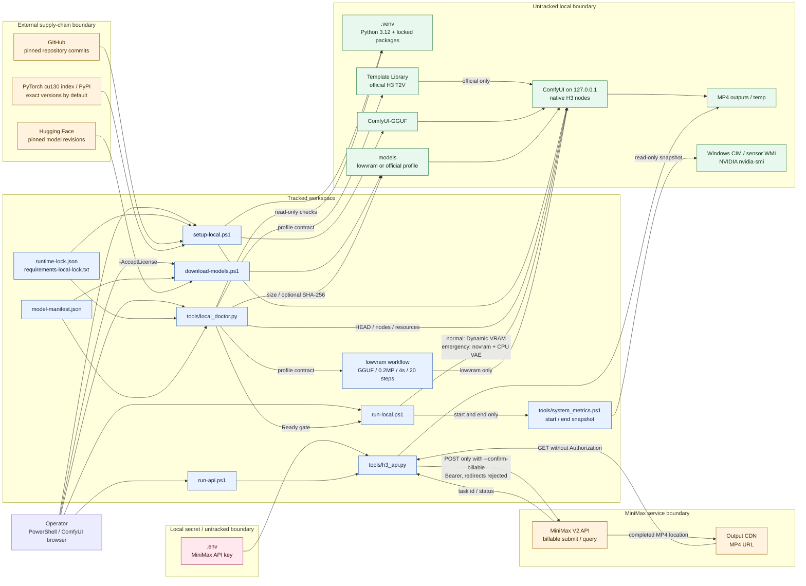

# Architecture diagram

この図は、tracked workspace、untracked local runtime、外部配布元、MiniMax APIの信頼境界と主要データフローを示します。責務と制約の詳細は[ARCHITECTURE.md](ARCHITECTURE.md)を参照してください。

Local経路のprompt/mediaはloopback ComfyUIへ渡ります。API経路のprompt/mediaはMiniMaxの外部境界を越えます。Bearer key付きrequestはredirectを拒否し、MP4 CDN downloadにはkeyを付けません。
