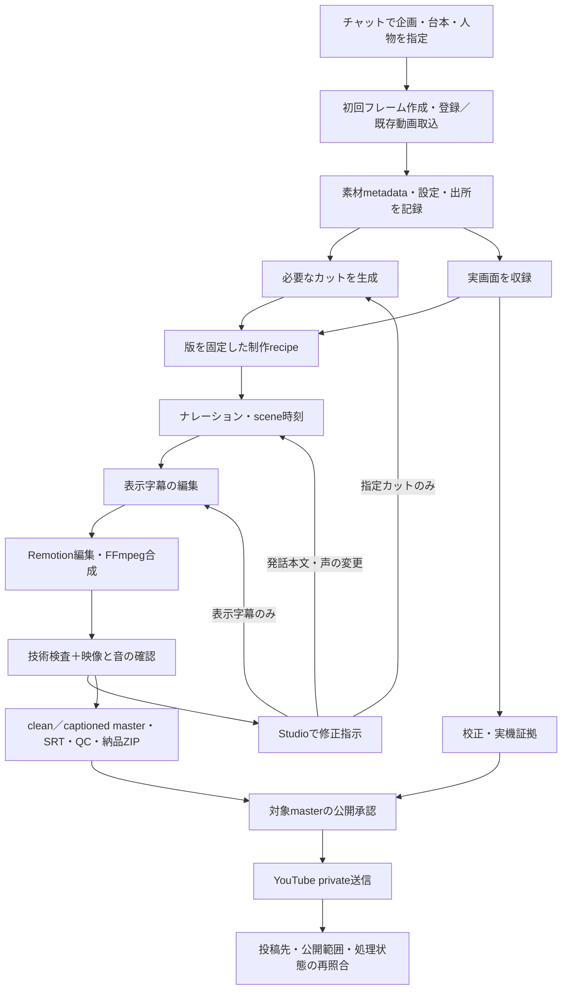
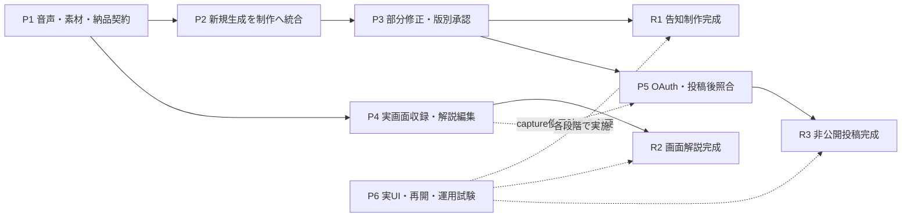

# 動画制作パイプライン完成計画

## 2026-09-06: 1種類の技術解説テンプレートへ集中

最新実績: Claude Desktopの了承済み架空データ1件から、1回収録→21秒・3区間／固定拡大→Sayaka音声／字幕→技術QC→標準納品まで成立。同素材の区間修正では音声cacheも再利用できた。入力・送信過程は収録せず、回答取得後の画面を編集している。高品質音声の聴感、スマートフォンでの読みやすさ、静止時間、別テーマ3本の運用受入は残る。詳細は[制作記録](productions/SHORT_20260906_claude_desktop_real_capture/PRODUCTION_RECORD_JA.md)。以下は着手時の優先順位を保持する。

ユーザーは動画編集には習熟しており、主な負担は素材集め、特にソフト実画面の準備。優先順位を「編集操作の簡略化」から「台本に必要な素材取得と再利用」へ修正する。`screen_explainer_ja_v1`で目的・操作・結果の3場面を標準制作経路へ接続する。今回の自動取得はローカルWeb画面、素材取込は一般動画に対応。外部サイト・ログイン済みアプリの自動取得と高品質音声の試聴・一括接続は未完了。

次の順序は、(1) 対象ソフト1種類の素材取得を実用受入、(2) 高品質音声を試聴して固定・再利用、(3) 同じテンプレートで公開候補3本を制作・修正して評価。自前NLE、低レベル収録、自動投稿の拡充は先行しない。[画面解説テンプレート](STUDIO_SCREEN_EXPLAINER_JA.md)を最新の境界とし、以下の日付付き記録は開発時点のスナップショットとして残す。

作成日: 2026-09-05

調査基準: `main` / `4285d9023f3598c61b2f20e09c08f3f28820e880`
対象: 個人フォークの MiniMax H3 Studio

## 2026-09-05 方針変更と今回の整備

ユーザーの指定により、YouTube自動投稿は当面の完成条件から外す。**動画と投稿用タイトル・説明・メタデータのテキストを取り出せればよい**。以下の初期計画に含まれるYouTube関連P5/R3は将来の任意拡張として扱い、課金契約や自動投稿UIを先行させない。

今回の実装は、取込素材の尺・解像度等の永続化、素材範囲preview、見出し・発話量の助言、鮮明化設定の導線、初回台本確認、3ステップStudioナビ、動画＋UTF-8投稿テキストの取り出し。手順と制約は [品質・UXガイド](STUDIO_CONTENT_QUALITY_GUIDE_JA.md) を参照。

次は、(1) 自然な高品質音声を一括制作へ接続し発話の間と字幕時刻を実測する、(2) 読み上げ本文と表示字幕を独立して直す、(3) 1カットの差し替えと版比較を短い操作で完了させる、の順を優先する。今回の助言UIだけでR1〜R3の実用完成や映像品質の最大化が達成されたとは扱わない。以下の調査表は実装前のスナップショットで、素材metadataと投稿用出口については本節を最新状態とする。

## 1. 結論と完成の定義

制作台帳、ローカル動画生成、音声、字幕、Remotion編集、技術検査、レビュー、納品ZIPの基盤は揃っている。完成に向けては、**高品質音声・新規生成・部分修正を一つの制作履歴へ接続し、実動画で繰り返し成立することを確認する**。

ユーザーの到達目標を次のように置く。

> チャットで企画・人物・文言を伝えると制作が進み、Studioで動画、中間成果物、費用、失敗理由を確認できる。気になる場面や字幕・音声を修正し、別の動画編集ツールを使わず納品物を作成できる。希望する場合はYouTubeへ非公開投稿し、投稿先の結果も確認できる。

過去のM1〜M6は開発履歴として維持する。本計画では、その残件を閉じる実用上の到達点をR1〜R3、作業単位をP1〜P6と呼ぶ。新たにM番号の意味を変更しない。

| 到達点 | ユーザーができること | 完成判定 |
|---|---|---|
| R1 告知動画の実用完成 | 15秒を基準に、新規人物素材／既存動画、自然なナレーション、読める字幕から告知を作り、1カットだけ直して納品 | P1〜P3と該当するP6試験が合格。既存素材・新規生成・部分修正の3ケースを実動画で完了 |
| R2 実画面解説の制作完成 | ログイン済みアプリやブラウザの画面を収録し、必要箇所を拡大して30〜60秒の解説へ編集 | P4と該当するP6試験が合格。文字の可読性、音声同期、実機収録、納品を確認 |
| R3 チャットから非公開投稿まで完成 | 確認した最終版を自分のYouTubeチャンネルへprivate投稿し、処理完了まで確認 | P5と公開経路のP6試験が合格。別APIによる投稿後照合と再開を確認 |

R1はYouTube直接投稿を待たず利用開始できる。人物が発話する映像の厳密なリップシンクは独立した評価課題とし、初期版はナレーション＋人物の非発話カット／操作画面で成立させる。リップシンク、2K化、60秒超、汎用マルチトラック編集はR1〜R3の受入対象に加えない。

## 2. 現在地と今回確認した接続不足

前回レポートから製品コードの基準コミットは変わっていない。調査開始時の未コミットファイルは `STUDIO_DEVELOPMENT_STATUS_JA.html` のみ。既存HTMLは2026-09-01のスナップショットとして保持する。

| 機能 | 現在の状態 | 完成に必要な接続・確認 | 根拠 |
|---|---|---|---|
| 既存素材→告知→字幕・音声→納品 | M1/M2、SAPI、詳細一括、13-entry Delivery ZIPあり | 実UI一気通貫試験、音声選択、素材尺の事前表示 | `studio/src/simpleCreateWorkflow.ts`、`tools/studio/quick_create_project.py` |
| 高品質音声 | ElevenLabs adapter、取得済み音声のscene alignment、assembly入力あり | 一括制作・Run profile・子Job・DeliveryがSAPI固定。UIから納品まで通す契約変更が必要 | `tools/studio/detailed_test_video.py:42`、同`:69`、`tools/studio/delivery.py:52`、`tools/studio/service.py:6211` |
| 3始点画像→3 I2VA | M4 CLIは3件×6秒を15秒へ編集する構成。送信・再開状態をJSON保存 | 生成側の状態はStudio Job/Runと別管理。実API品質・時間・費用、生成画像履歴、Studio導線が未受入 | `tools/studio/shot_orchestration.py:36`、同`:424`、同`:685`、`tools/studio/cli.py:606` |
| レビュー→1カット修正 | M3の対象cutと修正計画を記録 | 実行adapterが `not_connected`。1カット生成、差し替え、再編集が未接続 | `tools/studio/reviews.py:257` |
| 素材metadata | bytes/mtime/hash等を共通登録。後段でメディア検証 | 尺、解像度、fps、音声有無の共通永続化がない | `tools/studio/database.py:636`、`tools/studio/indexer.py:215`、`studio/src/api.ts:3303` |
| Windows収録 | primary display＋system audio、1〜30秒、8成果物、停止処理あり | 校正Jobと独立した証拠がないためacceptanceは常にblocked。実機合格が必要 | `tools/studio/windows_capture.py:43`、`tools/studio/windows_capture_acceptance.py:660` |
| 操作画面の編集 | 1920×1080収録と1080×1920のRemotion編集あり | 現在の `objectFit: cover` は横画面の左右を切る。画面用レイアウトと30〜60秒の制作recipeが必要 | `studio/src/remotion/TimelineComposition.tsx:32`、`tools/studio/announcement_video.py:33` |
| YouTube送信 | private/unlisted、channel preview、確認digest、再開ledger、DPAPIあり | OAuth導線、UI、投稿後read-back、処理完了確認、実投稿が未実装／未受入 | `tools/studio/youtube_publish_execution.py:274`、`tools/studio/youtube_publish.py:753` |
| 公開承認 | production全体の3カテゴリーのreviewを確認 | 選択master/revisionへの承認拘束と、使ったcaptureのacceptance参照がない | `tools/studio/reviews.py:564`、`tools/studio/youtube_publish_binding.py:154` |

公開承認の接続は実upload前の必須作業とする。現在のWindows acceptanceのblockedは、YouTube送信全体を自動的に止める共通ゲートにはなっていない。また、旧版への承認を新しいmasterへそのまま流用しないようにする必要がある。

## 3. 目標ワークフローと依存関係

MiniMax APIの最小試験は、現CLIを使ってP1と並行して前倒しできる。サービス・モデルの利用可否と品質を早期に確認し、その結果をP2へ反映する。実APIの契約や結果が揃わない間も、既存素材によるP1は進められる。

## 4. 実装する作業単位

### P1: 高品質音声から納品まで接続する

1. `duration_ms / width / height / fps（有理数）/ has_audio / codec / probe_status` を、素材hashとprobe版に結び付けて保存する。取込直後・生成完了時に取得し、未取得素材だけを後から補完する。
2. 制作recipeへ版付きの音声選択契約を追加する。SAPI、取得済み外部TTS、voice-upgrade結果の区別を保存する。
3. Announcement→Detailed→assembly→QC→DeliveryのRun/profile、子Job種別、音声source、cache、成果物登録を整合させる。旧SAPI recipeと既存13-entry ZIP契約を維持する。
4. Studioの簡単作成へ声の選択、試聴、発音調整、必要な費用確認を追加する。表示字幕は発話原稿と別に編集できるようにし、既存音声の時刻情報を使う。原稿がsceneの尺に収まらない場合は、原稿短縮・scene延長へ戻れるようにする。
5. 将来のcaptureも使える、最終masterから素材・音声・QCへ辿れる共通契約を定義する。clean-only packageを追加する場合は別の明示したpackage版として扱う。

完了条件: 既存素材3本を使い、選択した音声で15秒のclean/captioned master、SRT、QC、ZIPを作成できる。表示字幕だけの変更は動画素材の再生成・TTS再課金を伴わず、映像だけの変更は既存の有効な音声を再利用する。発話本文・声・provider・発音指定を変更した場合は、TTS再生成と必要な追加費用の対象として表示する。素材尺不足は生成・課金前に検出する。人物の口の動きへの音声同期はこの合格条件に含めない。

主な対象: `production_intake.py`、`database.py`、`announcement_video.py`、`detailed_test_video.py`、`voice_upgrade*.py`、`delivery.py`、Studioの簡単作成／納品画面。

### P2: 新規生成をStudioの制作履歴へ統合し、実APIで受け入れる

1. チャットの画像生成で用意した初回フレームを、参照画像・プロンプト・生成日時・hashと一緒に登録する。まず既存の画像生成と取込をつなぎ、追加の画像API契約は必須にしない。
2. 既存shot-projectのstateを生かし、Production/Run/Jobに生成cut、task ID、入出力artifactを関連付ける。CLIとUIが同じ状態を参照し、別々に再送しない。
3. 3カットの開始画像、文言、見積と承認、生成中／完了／確認待ちを簡単作成に表示する。provider応答が不明なら、その理由と再照合手段を表示する。
4. 現契約の3 task上限で有料smokeを1制作分実施し、実生成MP4から音声・編集・納品まで通す。task数上限と金額上限は別に記録する。
5. 同じrequestを再送しても有料taskを増やさず、成功素材と完成masterを再利用できることを確認する。

完了条件: 「参照人物→初回フレーム3枚→I2VA 3本→15秒動画→ZIP」をチャットまたはStudioから実行し、各生成の時間・費用・出所を辿れる。実際の人物一貫性、動作、音声の自然さを確認する。MiniMax側でmodel・API契約・利用可否に差があった場合は、この試験結果を反映してadapterを更新してから追加課金する。

主な対象: `shot_orchestration.py`、`h3_api.py`、`quick_create_project.py`、`service.py`、`server.py`、生成cut一覧UI。

### P3: 指定カット修正と、完成版ごとの承認を閉じる

1. `m4_cut_revision_job_v1` を実装し、M3のrevision planを1カット生成Jobへ接続する。3本一括処理から単一cut処理を切り出して利用する。
2. 新revisionへ対象cutだけ差し替え、他cutのartifact/hashを保持して、編集・assembly・QCを再実行する。
3. 旧版と新版の比較、旧版の選び直し、未解決コメントをStudioで扱う。自動的に「修正済み」とするのは処理成功までとし、内容の承認はレビューで判断する。
4. 公開承認をmaster hash、revision、選択variantへ結び付ける。production全体のレビュー集計は一覧表示に残し、送信許可には対象版の承認を使う。

完了条件: 「2カット目だけ動きを増やす」の指示で、追加生成は該当1件のみ。他2本のhashは同一で、旧版、新版、追加費用を確認できる。captioned/cleanの選択やmaster変更で、対象外の旧承認が使われない。

P1〜P3の受入後、R1として告知制作を日常利用に移す。

### P4: 実画面収録を、読みやすい解説動画へつなぐ

**P4-A 収録と校正**

- 可視flashと可聴toneを出す専用fixture、検出器、校正Job、登録済み証拠artifactを作る。測定できた事実と目視・聴取結果を別に記録する。
- 現基準である最大A/V差50ms、音量 -24〜-10 LUFS、true peak -1dBFS以下を実機で検証する。基準を変える場合はpolicyの版と理由を残す。
- device切替、親process強制終了、child終了、partial cleanup、再収録を試験する。cursorや機密混入は対象動画を人が確認する。
- 校正による収録構成の資格と、個別収録の内容レビューを区別する。別の録画の校正結果だけで全録画の内容同期・privacyを自動承認しない。
- 使用したcaptureの出所と受入記録をmasterまで引き継ぎ、公開判定から参照する。

**P4-B 画面用レイアウトと尺**

- 1920×1080の横画面を縦キャンバスへ入れる際、全体表示／明示領域の拡大／画面と見出しの上下配置を閉じたpresetとして追加する。プレビューと書き出しに同じ配置を適用する。
- 初期収録は現在のprimary display＋1〜30秒単位を使い、複数clipを編集して30〜60秒にする。ログイン済みアプリはユーザーが表示した画面を収録する。特定windowの選択や外部ブラウザ自動操作は別の追加項目とする。
- 既存10〜20秒・3sceneの告知recipeとは別に、30〜60秒の解説recipeを追加する。ナレーションを先に確定し、説明箇所と画面clip、字幕を合わせる。
- 1080×1920/24fpsの30秒・60秒を実レンダーし、文字の可読性、必要disk、最大メモリ、処理時間を記録する。横型masterへの対応は需要を確認して別途見積もる。

完了条件: 例えば「ログイン済みツールの設定を1つ解説する」45〜60秒動画で、操作対象と文字が読め、声と画面が一致し、受入済みsourceからZIPまで作れる。人物の口元へナレーションを合わせる必要はない。

主な対象: `native/windows-capture-helper/`、`windows_capture*.py`、`TimelineComposition.tsx`、`remotion/model.ts`、`remotion_timeline*.py`、新しい解説recipe、capture/preview UI。

### P5: YouTubeへprivate投稿し、投稿後を照合する

1. Desktop OAuthを、システムブラウザ、PKCE、state、loopback callbackで実装する。認可したscopeとchannelを確認し、refresh tokenは既存SecretStoreへ保存する。upload・channel照合・private videoのread-backに必要な権限を実際に検証する。
2. 確認画面に対象master、タイトル、投稿先channel、private範囲を表示し、既存preview digestと実行確認へ接続する。
3. upload受領とYouTube側の処理完了を別状態にする。`videos.list`等でvideo ID、channel、privacy、processing状態を取得し、失敗・反映待ちも記録する。
4. 既存resumable ledgerを使い、中断後は既知sessionを照会して再開する。応答消失を新規uploadで代替しない。

完了条件: 明示した動画1件をprivate投稿し、別APIの照合結果と動画URLをStudioに保存できる。二重操作・一時切断で投稿が増えない。captureを使う動画にはP4のsource受入が必要。既存素材だけの動画でOAuth／upload試験を先行できる。

Google公式は未監査API projectからのuploadをprivateに制限しているため、最初の受入はprivateに固定する。unlistedはその制限とアカウント状態を確認した後の追加受入とし、public uploadは今回の範囲に入れない。[公式 videos.insert](https://developers.google.com/youtube/v3/docs/videos/insert)

OAuth導線は[Desktop OAuth公式手順](https://developers.google.com/identity/protocols/oauth2/native-app)、投稿後照合は[公式 videos.list](https://developers.google.com/youtube/v3/docs/videos/list)を基準にする。後者のprocessing情報には動画所有者としての認証が必要。公式資料確認日: 2026-09-05。

### P6: 実UI・再開・日常運用の受入を各段階へ組み込む

- 実ブラウザで「簡単作成→プレビュー→字幕修正→ZIP」を操作するE2Eを追加する。既存のNode／ソース検査テストと役割を分ける。
- DB、原素材、生成物、recipe、秘密情報を区別したバックアップ／復元手順を作り、別の作業用コピーへ復元して再編集可能と確認する。DPAPI暗号文をコピーするだけで別PCから使えるとは扱わない。
- Studio再起動、TTS後の中断、render停止、既知ComfyUI task回収、API応答消失を検証する。実GPU強制終了試験は他の制作を動かしていない専用試験で行う。
- 完成masterから原素材、初回フレーム、音声、費用、QC、レビューへ辿れる導線を確認する。請求から取得できない費用は未確定と表示する。
- 定常監視はアプリが担当し、Codexは開始、承認待ち、失敗、完了の節目を中心に取得する。既存UIの2秒poll自体はLLMトークンを使わない。重複pollの共通化や非表示時backoffは保守性・負荷改善として実施する。
- 変更部分に合わせて `ARCHITECTURE.md` と `ARCHITECTURE_DIAGRAM.md` を更新し、再現手順と受入証拠を残す。署名付き監査bundleは、復元可能な履歴とsource追跡が成立した後に検討する。

## 5. 最終受入に使う代表作品と失敗試験

| ID | 作品・試験 | 合格条件 |
|---|---|---|
| A1 | 既存動画＋SAPI、15秒告知 | UIから字幕・音声・QC・ZIP。再実行で不要な処理を増やさず、字幕の読みやすさと自然な間を確認 |
| A2 | 新しい人物＋初回フレーム3枚＋I2VA＋ElevenLabs | 3 task上限、明示予算内。人物一貫性、発音、動作、scene同期を確認。実費・時間・出所を記録 |
| A3 | A2の2カット目だけ修正 | 再生成1件、他2本のhash不変。新revisionのmaster／QC／ZIP。旧版比較と対象版の再承認 |
| A4 | 30〜60秒の実画面解説 | 画面文字が読める。台本・音声・画面が一致し、capture証拠と出所を引き継ぐ |
| A5 | A1等をprivate投稿 | 自分のchannel、private、正しいvideo ID、処理完了をread-back。再試行で追加投稿なし |
| F1 | TTS後に停止し、再起動・再実行 | 成功済み音声を再利用し、重複課金しない |
| F2 | 生成API送信の応答消失 | task不明を表示し、無条件再送しない。既知taskは再照合して回収 |
| F3 | master変更後に旧承認で送信 | 対象版の承認不一致として停止 |
| F4 | 収録中device切替／親process終了 | 不完全成果物を公開せず、子process・partialの処理結果を記録 |
| F5 | 素材不足・disk不足・破損・cache改変 | 原因を表示し、既存の正常成果物を保持して復旧できる |

自動検査に加えて、完成動画は実寸に近いスマートフォン表示で全編の映像と音を確認する。小さすぎる文字、被写体の顔を隠す字幕、文言量過多、発話sceneのずれ、意図しない長い静止を評価する。Technical QCの成功だけで作品として合格にしない。

## 6. 契約・ユーザー操作が必要になる時点

| サービス・操作 | 必要になる時点 | 最小の確認単位 |
|---|---|---|
| MiniMax API | P2の実生成試験。現CLIで前倒し可能 | 3カット1制作、task上限3。実行前に利用可能model・見積・金額上限を確認 |
| ElevenLabs | P1の日本語音質受入 | 試聴用短文と1制作分。追加試行を含める予算を先に確認。SAPI経路は契約不要 |
| 画像生成 | 初回フレーム作成 | 当面は現在のチャットの画像生成を利用し、その結果を登録する |
| Google / YouTube | P5のOAuth接続・実投稿 | API有効化、Desktop OAuth client設定、ユーザーのブラウザ認証、private 1件。定額の動画生成API契約とは別の準備 |
| Windows実機操作 | P4-Aの最終受入 | 対象アプリ表示、device切替、cursor／画面内容の確認など、立会いが必要な範囲を事前にまとめる |

キーやrefresh tokenをチャットやGitへ貼らず、ローカル設定から登録する。本調査は計画とローカル検証までで、課金生成・録画・投稿は実施していない。

## 7. 開発の進め方・見積り

| 作業 | 暫定工数 | 最初に切り出す単位 |
|---|---:|---|
| P1 音声・素材・納品接続 | 3〜5人日 | media metadataと版付き音声／master契約→backend→簡単作成UI |
| P2 新規生成統合・実API受入 | 2〜4人日 | 現CLIのpaid smoke準備→cut状態をStudioへ表示→一括経路接続 |
| P3 部分修正・対象版承認 | 3〜5人日 | 単一cut生成→revision差し替え→対象masterの承認 |
| P4 収録校正・画面解説 | 6〜11人日 | 校正fixtureと画面レイアウトを並行→実機→解説recipe・実レンダー |
| P5 OAuth・private投稿後照合 | 3〜5人日 | OAuth／scope検証→UI→read-back→実private投稿 |
| P6 復旧・実UI・運用試験 | 2〜4人日 | 各機能に試験を分散し、最後に復元と代表作品を通す |

合計19〜34人日相当の暫定見積り。AIが連続作業する経過時間や納期の約束ではなく、未接続部分をレビュー・実機試験込みで分解した目安である。R1の主要実装はP1〜P3の8〜14人日相当で先行できる。APIの実際の品質、Windows校正の結果、認証の準備状況で変わるため、P1完了と最初のpaid smoke後に見積りを更新する。

並列化する場合は、次の3担当と統合担当に分ける。

- 担当A: 音声／master契約とP1 backend。
- 担当B: M4／M3の生成・差し替え（P1契約確定後に統合）。
- 担当C: capture校正またはOAuthの独立部分。
- 統合担当: shared schema、`service.py`、`App.tsx`の接続、レビュー、実UI／実動画受入、ドキュメント。

`service.py`は約1万行、`App.tsx`は約5,800行あり、複数担当が同時に編集すると競合しやすい。機能moduleへ処理を切り出し、これらの接続箇所は統合担当が管理する。全体の作り直しは先行条件にしない。

## 8. 調査時の検証記録

- 2026-09-05: Studio frontend **146 / 146 passed**、production build成功。既存の約919kB JS chunk warningあり。
- 2026-09-05: Python製品テスト649件を331.295秒で実行し、**648 passed / 1 skipped / 0 failures**。skipはWindows上で対象外となるnon-Windows専用試験。
- 実行入口: `.venv\Scripts\python.exe -m unittest discover -s tests -p 'test*.py'`（`PYTHONUTF8=1`）、`studio/`で `npm.cmd test` と `npm.cmd run build`。既設Python 3.12.2／Node 20.19.0を使用。
- frontendテストにはpayload/helperの検証とTSXソースの文字列検査が含まれる。実DOMから一括制作を通す受入の代用にはしない。
- rootに `.github` はなく、本調査でGitHub CIの成功は確認していない。既設のローカル環境で検証した。
- 過去の実動画証拠: local H3 5.167秒・一括7分24秒（2026-08-26）、Remotion 15.000秒・131.891秒render（2026-08-29）。今回再生成した性能値ではない。根拠: `STUDIO_MVP_JA.md:836`、同`:850`。
- 公式への変更送信は対象外。コード統合時の送信先は、ユーザー指定の個人フォーク `benriworks/MiniMax-H3`。

現在の構成の詳細は [ARCHITECTURE.md](ARCHITECTURE.md)、図は [ARCHITECTURE_DIAGRAM.md](ARCHITECTURE_DIAGRAM.md)、既存実装・過去の受入記録は [STUDIO_MVP_JA.md](STUDIO_MVP_JA.md)を参照する。本書は未実装項目の計画であり、現在の構成図を将来構成で置き換えるものではない。

## 9. 次に着手する最小の実装

**P1の「素材metadata＋音声source／master契約」から開始する。** これが決まると、高品質音声、M4、captureを既存の編集・納品へ接続できる。

最初のレビュー対象を「既存3素材＋選べる音声→15秒→QC→ZIP」の一本に固定する。同時にMiniMaxの3 task paid smoke手順と費用確認画面を準備し、API利用の条件が揃い次第、現実の生成品質を先に確かめる。
## 静止画素材の追加進捗（2026-09-10）

次の2段階を実装：①1〜12場面の撮影手順を保存・並べ替え・複製し、撮影フォームへ再利用。②画像を場面に割り当て、内容確認後に順序付きPNGとMarkdownを記事素材パックとして持ち出す。版履歴・再送照合・確認digest・原本hashで、再調整と持ち出し内容の追跡を支援する。

次の候補は、撮影手順と実アプリ操作を結び付けた半自動収集、場面ごとの差し替えを分かりやすくする比較UI、Codexデスクトップの対象識別。現段階では保存した手順を自動実行せず、native対象選択と撮影許可は毎回行う。VM・導入記事・音声ノイズ改善は引き続き保留。詳細は`STUDIO_STILL_LIBRARY_JA.md`を参照。
