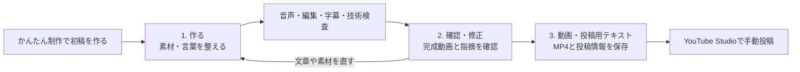

# Studio コンテンツ品質・制作ガイド

> 2026-10-30：制作を始める／再開する際は [索引](docs/video-production/README.md) → [総覧](docs/video-production/PRODUCTION_KNOWHOW_JA.md) → 対象案件の再開記録を確認する。本書は実装・操作の詳細資料。新しい判断と次の作業は各 `RESUME_AND_KNOWHOW_JA.md` へ残す。

2026-10-23追記：人物キャラの初期確認からMiniMax人物動画、物語、公式引用、Geminiナレーション、保存・レビュー・GitHub資産化までの運用は [制作全体のガイド](docs/video-production/README.md) を参照。音声担当へは [ナレーション別冊](docs/video-production/NARRATION_HANDOFF_JA.md) を渡す。以下のStudio UI操作の説明は従来の機能・時点の記録として保持する。

更新日: 2026-09-05

このガイドは、既存の動画素材を使い、約15秒の縦動画を作って、動画と投稿用テキストを手元に保存する手順です。今回の整備では、素材や台本を作成前に確認しやすくし、完成後の見直しと手動投稿へ進みやすくしました。

## まず使う画面は3つ

制作を選択すると、次の3ステップが前面に表示されます。「素材・成果物」も常に選べます。

| 画面 | ここで行うこと |
| --- | --- |
| 1. 作る | 素材、見出し、読み上げ文を選び、字幕・音声付き動画を作る |
| 2. 確認・修正 | 対象動画と時刻を指定して気になる点を残し、確認結果を記録する |
| 3. 動画・投稿用テキスト | 完成動画を再生・保存し、タイトル・説明文・タグをテキストで取り出す |

画面収録、音声単体の生成、カット編集、詳細一括、ログ、監査・費用などは「詳細ツールを開く」から使えます。詳細ツールを閉じても処理を停止する操作にはなりません。

## 初めて作る: 「かんたん制作」

1. 「かんたん制作」を開き、制作の名前を入力します。
2. 「告知」「イベント案内」「採用・募集」から用途を選びます。
3. 動画ファイルを1〜3件選びます。選択順が「つかみ→要点→案内」に対応します。1件なら3場面とも同じ素材、2件なら後半2場面に2件目を使います。
4. 「いちばん伝えたい文言」を入力します。2行以内、1行あたり全角10文字相当（半角20文字相当）までです。
5. 「確認して一括作成」の台本カードで、3場面それぞれの大見出しと読み上げるセリフを確認します。
6. 内容がよければ「この内容で一括作成」を押します。

台本カードには、テンプレートと入力文から実際に作る台本が表示されます。この段階は文章の確認で、音声を先に試聴する画面ではありません。つかみや最後の案内も個別に変更したい場合は、「詳細設定から始める」を利用するか、作成した制作を「1. 作る」で開いて調整します。

初回の一括作成はWindowsのローカル音声を使い、素材音を読み上げへ置き換えます。外部API料金は発生しません。入力文は制作記録の一部になるため、API tokenや秘密情報は台本に入れないでください。

## 「1. 作る」で素材と文章を整える

### 素材は使用範囲を見て選ぶ

「かんたん作成」には、つかみ・伝えたいこと・最後の案内の3場面があります。各場面の動画を選ぶと、取得済みの画素数、長さ、fps、素材音の有無、動画形式を表示します。確認できない項目は「不明」「未確認」のまま表示します。

「使う範囲を再生」を押すと、指定された開始位置から再生し、終了位置で停止します。通常の再生コントロールでも操作できます。最初はミュートで、自動再生はしません。

この小さなプレビューは、素材と見出しの組み合わせを確認するためのものです。完成動画の読み上げ、焼き込み字幕、場面のつなぎ、鮮明化は反映しません。重ねた見出しの位置や大きさも目安です。ブラウザーで素材を再生できなくても、別素材の選択や文章の編集は続けられます。

完成する縦画面を想定し、特に次を見ます。

- 顔や手が枠の外に切れていないか。
- 見出しが顔や読ませたい箇所に重ならないか。
- 使う範囲の最後まで必要な動きが続いているか。
- 前後の場面で似た映像が続きすぎていないか。

横長素材は、縦画面を満たすため中央を残して左右を切り取ります。取得済みの寸法から残る横幅のおおよその割合を案内します。例えば1920×1080の素材を9:16へ中央で切り取ると、残る横幅は約32%です。ソフトの実画面など、左右の文字が重要な素材では特に確認してください。

切り出す秒数を変更したい場合は、同じ「1. 作る」の「詳細設定」で開始・終了を調整します。かんたん作成の既定と異なる詳細設定を含む場合は、その設定を確認できるよう詳細表示に切り替わります。

### 見出しは結論、読み上げは補足にする

見出しの下に、文字数、行数、最も長い行の表示量を出します。上限は2行、各行全角10文字相当（半角20文字相当）です。半角英数字は全角より細いものとして数えるため、「文字数」と「全角相当」は一致しない場合があります。

読み上げ文の下には、場面で使う秒数と、句読点や空白を除いた文字数を表示します。日本語だけの文章には、文字量から計算した幅のある所要時間の目安も表示します。声、速度、間によって変わるため、実際の音声時間ではありません。英数字や略語が含まれる文章は読み方の影響が大きく、秒数の目安を表示せず、発音と実際の長さを確認するよう案内します。

| 気になる表示・仕上がり | 調整の例 |
| --- | --- |
| 見出しが長い | 説明を削り、結論だけ残す。意味の区切りで2行に分ける |
| 読み上げが場面に収まりにくい | 言いたいことを1つに絞る。必要なら詳細設定で秒数を調整する |
| 見出しと字幕を同時に追えない | 見出しを短くし、細かい説明は読み上げへ移す |
| 製品名や略語の発音が不自然 | 詳細設定の発音置換などを使い、生成した音声を確認する |
| 同じ素材で単調に見える | 場面ごとに素材を変えるか、見せる範囲を変更する |

助言は編集の参考情報で、助言があること自体は作成を禁止しません。ただし、空の必須項目や見出しの行数上限など、既存の入力条件に違反する内容は修正が必要です。助言が表示されない場合も、作品の品質が自動的に承認されたわけではありません。

### 低解像度素材の鮮明化を選ぶ

対象の縦素材では「低解像度の縦素材を少し鮮明にする」を選べます。取得済みの寸法が不明な素材や、横長素材など対象外の素材では選べません。適用時にも実際の素材寸法を再確認します。

この処理は、拡大時の輪郭の甘さを弱い固定補正で補うものです。元動画にない細部を復元する超解像ではありません。処理時間が増えるので、人物の輪郭、髪、衣服などが自然に見えるかを完成動画で確認してください。

対象条件は、両辺64px以上、幅1080px未満、高さ1920px未満、幅÷高さが0.50〜0.625、縦画面を満たす拡大後の画素数が300万以下です。現在の480×864のH3素材は寸法条件に入ります。素材を変更するときは、その素材で補正を使うか改めて確認します。

## 完成動画を確認して修正する

動画の作成ボタンを押すと、内容の保存後に音声、編集、字幕、技術検査へ進みます。完成後は音を出し、少なくとも1回通して確認します。

「2. 確認・修正」では、対象成果物、対象の制作実行、時刻を選び、気になる内容を記録できます。「声が速い」だけでなく、「6秒付近の説明を読み終わる前に場面が変わる」のように書くと、次の調整で使いやすくなります。表現・権利・公開可否の判定は記録として残ります。

文章や素材を変更する場合は「1. 作る」へ戻り、保存した内容から編集して再作成します。未保存の変更があるまま画面を移動すると、変更を破棄するか確認されます。

「このcutの修正planを作成」は、修正計画を記録する既存機能です。現時点では、このボタンだけで指定カットの動画生成や再編集が実行されるわけではありません。

技術検査は動画や音声の技術的な条件を確認します。伝わりやすさ、発音の自然さ、出演者の口の動きとの一致は完成動画を見聞きして判断します。

## 動画と投稿用テキストを保存する

生成・合成・技術検査が終わり、必要な成果物が揃ったら「3. 動画・投稿用テキスト」を開きます。

1. 「字幕なし」「字幕あり」の完成動画を再生し、使う方を保存します。
2. タイトルと説明文を入力します。タグは任意です。
3. 「投稿情報をコピー」または「投稿情報を保存（.txt）」を押します。
4. 必要なら「納品ZIPを作成」を押し、動画と制作記録をまとめて保存します。
5. YouTube Studioを開き、保存した動画をアップロードします。テキストのタイトル、説明文、タグをそれぞれの欄へ貼り付け、公開日時や公開範囲を設定します。

「字幕なし」は、読み上げ由来の字幕を焼き込んでいない `master-clean.mp4` です。先に映像へ合成した大見出しは残ります。「字幕あり」の `master-captioned.mp4` は、それに読み上げ字幕を加えた版です。どちらも自動的にすべての文字が消える版ではありません。

投稿用テキストは現在のフォーム入力をまとめたもので、タイトルや説明文をAIが自動で執筆する機能ではありません。次の内容が入ります。

- タイトル、説明文、タグ、情報作成日時。
- 制作ID、制作実行と元処理のID。
- 2種類の動画のファイル名、成果物ID、SHA-256、サイズ。取得できる場合は長さや解像度。
- 現在の入力と納品ZIPとの対応状況。

タイトルは100文字以内、説明文は5000文字以内です。タグはカンマまたは改行で区切れます。タグは30個以内、各100文字以内、区切りを含む合計500文字以内です。これはこのフォームの入力条件で、投稿先の追加条件はYouTube Studio上で確認します。

テキストファイルはUTF-8で保存します。自動コピーを利用できない環境では、選択可能なテキスト欄が開くので、そこから手動コピーできます。フォームを変更したら、もう一度コピーまたは保存してください。

### テキストと納品ZIPの関係

タイトルや説明文を後から変更しても、作成済みのZIPは自動更新されません。同じ内容をZIPにも保存したい場合は、納品ZIPを再作成します。画面上には、作成前・内容一致・内容変更・比較できない状態を表示します。

タグは投稿用テキストだけに含まれ、ZIP内の `publication.json` には入りません。画面を再読み込みした後など、ZIP依頼時のフォーム内容をこの画面で照合できない場合は、その旨を表示します。

投稿情報の入力欄と直前のテキスト出力は画面内の状態です。再読み込みや別の制作への移動に備え、必要な内容は `.txt` で保存してください。ZIPを作成した場合は、その依頼時点のタイトル・説明文をZIPにも保存します。

## 現在の範囲と今後の整備

| 項目 | 現状 |
| --- | --- |
| 高品質API音声 | ElevenLabsなど既存の個別機能はありますが、今回のかんたん一括作成へ高品質音声を選んで自動接続する機能は未実装です。今回の一括作成はWindowsローカル音声です |
| 表示字幕と読み上げの独立編集 | 大見出しと読み上げ文は別に編集できますが、読み上げから作る字幕について、表示文だけを独立して調整する編集機能は未実装です |
| リップシンク | 話者の口をナレーションに合わせる処理はありません。素材の口の動きと読み上げが一致する前提では使えません |
| 旧素材の情報 | 今回の新規動画取込では計測済みの情報を保存・表示します。旧生成素材を一覧表示のたびに自動再計測する機能はありません。不明は不明として表示します |
| 投稿情報 | フォームで入力したタイトル・説明文・タグをテキスト化します。内容の自動執筆や投稿先への自動送信は行いません |
| YouTube投稿 | 動画と投稿用テキストを取り出し、ユーザーがYouTube Studioで投稿する手順です |

今回の整備・試験では有料API呼び出しとYouTubeへの自動送信を実行しません。品質改善の次の焦点は、高品質音声の一括制作への接続、表示字幕の調整、完成映像を確認しながらの再編集です。

## 関連ドキュメント

- [Studioの機能・契約](STUDIO_MVP_JA.md)
- [動画制作パイプライン完成計画](STUDIO_COMPLETION_PLAN_JA.md)
- [アーキテクチャ](ARCHITECTURE.md)
- [アーキテクチャ図](ARCHITECTURE_DIAGRAM.md)
