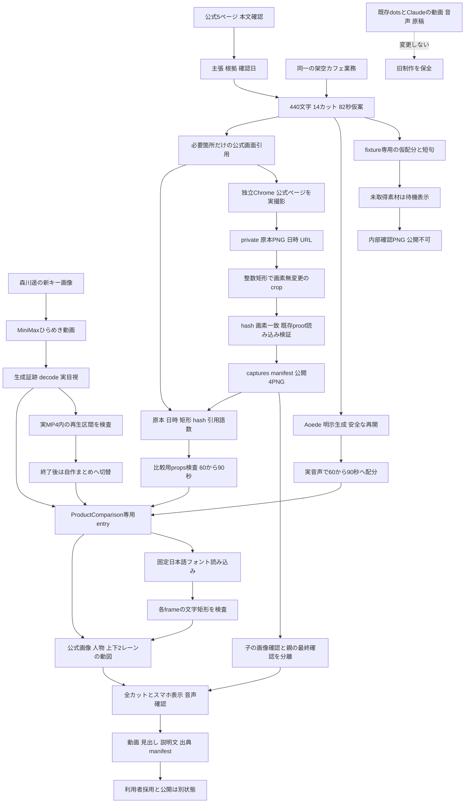
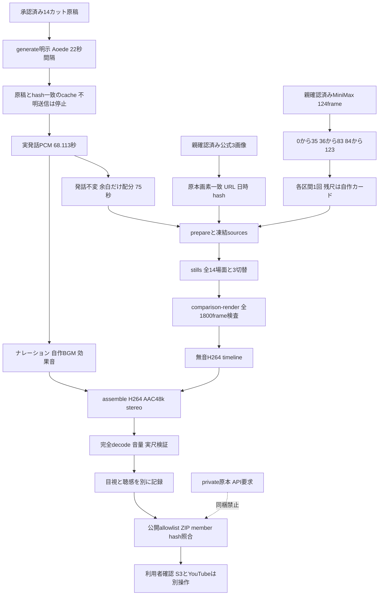
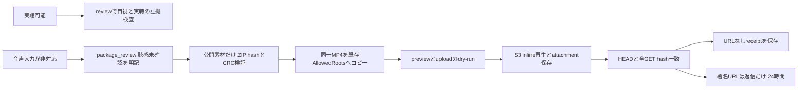
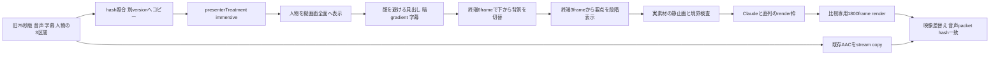

# 比較動画の構成図

比較専用の実素材production経路を実装。実音声14区間68.113秒を無加工で75秒へ配置し、fixtureと公開候補を分ける。

全画面改訂は1800frame描画、旧AACのpacket hash一致、全decode、14場面と15切替点の目視まで確認済み。旧版と別の出力・state・ZIPを保持する。S3の最新共有状態は改訂出力のdelivery-manifestとURLを含まないreceiptsへ記録し、署名URLは返信だけで渡す。聴感と利用者採用は未確認。
