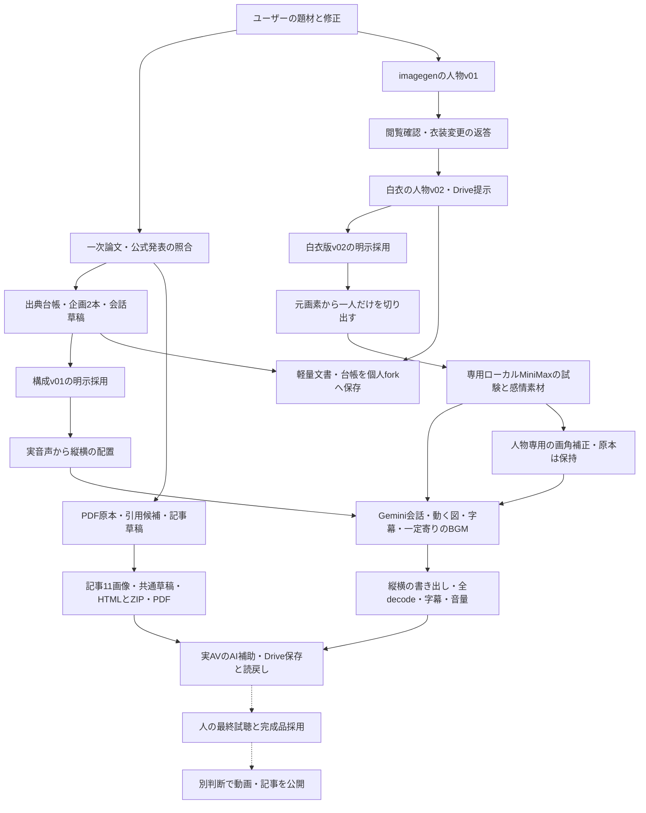
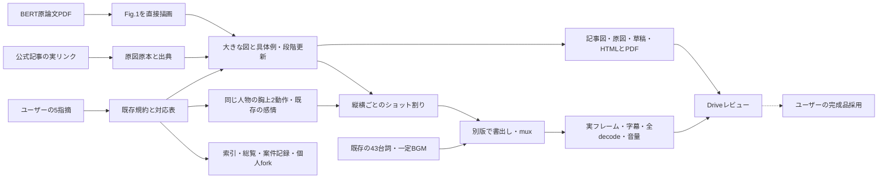
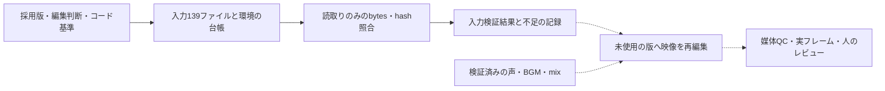

# 【AI】BERT・GPT誕生史：制作の流れ

更新：2026-11-06。本文は[ARCHITECTURE.md](ARCHITECTURE.md)。実線は実行した工程、破線は人による最終採用・媒体公開を示す。媒体ごとの検査状態は案件履歴を参照。

白衣版と構成は採用済み。上図は初回工程を表す。旧short v03／full v02は技術確認後、ユーザーが編集品質を差し戻した。下図の改訂で最新short v07／full v05、記事v04・PDFv06を作成し、全decode・字幕・音量・指定箇所の実フレームとDrive保存読戻しを確認した。ローカル人物は旧10＋胸上2を保持し、実使用は旧6＋新2。人の最終試聴・完成品採用・公開は未完了。動画・音声・PDF原本・私的共有情報はGitに入れない。

## 編集改訂の接続（2026-11-06）

公式原図の直接取得とPDF描画を、PCのブラウザ撮影に置き換えない。旧版を保持し、人の最終試聴・採用・公開は別状態で残す。

## 再現手順と入力台帳

実線は今回記録・確認した経路、破線は[再現手順](REPRODUCTION_JA.md)に残した実行経路。今回の文書更新で動画やPDFを再生成したものではない。
