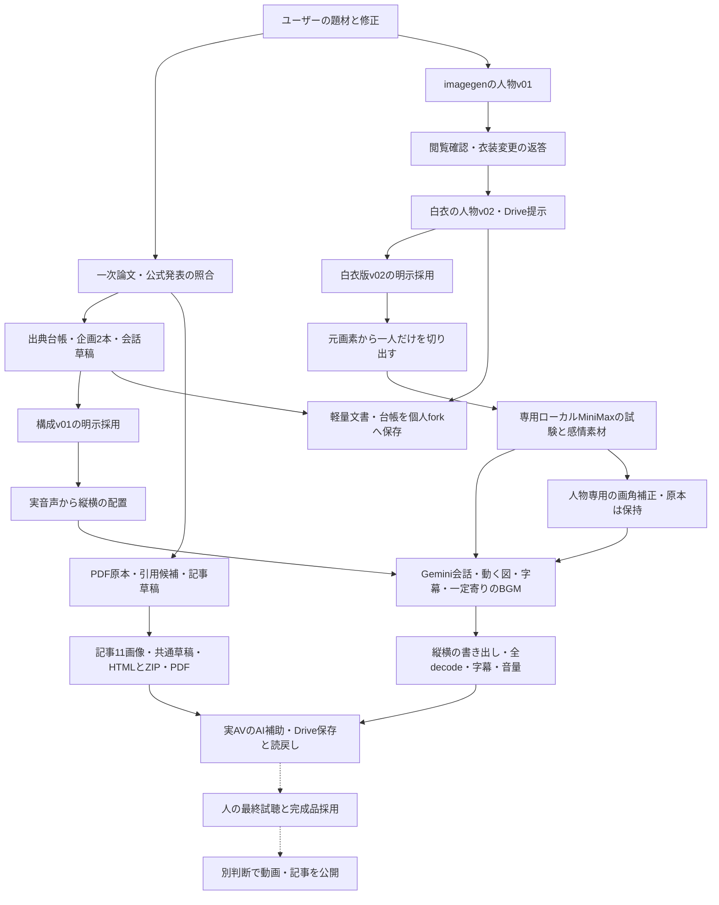

# 【AI】BERT・GPT誕生史：制作の流れ

更新：2026-11-06。本文は[ARCHITECTURE.md](ARCHITECTURE.md)。実線は実行した工程、破線は人による最終採用・媒体公開を示す。媒体ごとの検査状態は案件履歴を参照。

白衣版と構成は採用済み。ローカルMiniMaxは10素材が完走。ショートv03は技術・実AV確認とDrive保存読戻し、フルv01は媒体QC後のAV確認中。図入りPDFv04とHTML/ZIPは準備済み。人の最終試聴・完成品採用・公開は未完了。動画・音声・PDF原本・私的共有情報はGitに入れない。
